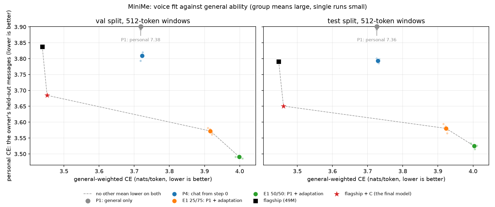

# MiniMe

**A small decoder-only language model, trained from scratch, to write in one person's voice — and a controlled study of what that costs.**

---

## Research objective

Large language models acquire a persona through instruction tuning on top of an enormous pretrained base. This project asks the opposite question, at a scale a student can actually afford:

> **How much of a person's writing voice can a fixed, tiny compute budget buy — and what does it cost in general language ability?**

The deliverable is not a leaderboard number. It is a **Pareto frontier**: style fidelity on one axis, general perplexity on the other, with each training strategy plotted as a point on it.



*Every model scored on the same 512-token windows, on val and on the sealed test split (read once). The final model is the 49M flagship, trained with the owner's chat mixed in from step 0, then adapted by candidate C (*M10* below). The probes are the controlled study; the flagship is a single run of another size and budget, so the plot describes and does not attribute.*

### What this is not

A 15–50M parameter model trained from scratch on ~1B tokens learns **voice**: lexis, sentence rhythm, punctuation habits, register, topic priors. It does **not** learn facts about my life, and it does not hold a coherent multi-turn conversation. Any project claiming otherwise at this scale is either using a pretrained base or not measuring carefully.

Stating that up front is part of the point. The interesting scientific question is exactly where the ceiling sits, and the evaluation harness is built to locate it rather than to flatter the model.

---

## Why small language models?

Three reasons, in order of honesty:

1. **Controlled experiments need repetition.** A claim about optimisers or data mixtures requires many runs under identical conditions. At 17M parameters an experiment arm costs ~1 GPU-hour, so an ablation is affordable and can be repeated across seeds to establish whether a difference is real.
2. **Small models make failures visible.** A 49M model that has overfit a personal corpus says so loudly. The same failure inside a 7B fine-tune is invisible without careful evaluation.
3. **Budget.** The entire project runs in ~30 GPU-hours of run time — about half that in session time, since Kaggle's free machine runs two jobs at once — which free-tier Kaggle covers.

---

## Architecture

A single implementation with every ablation exposed as a config switch, so an architecture experiment is a one-line config diff and never a second copy of the model.

```
tokens → embedding → [ pre-norm decoder block ] × N → final norm → tied LM head
                        ├── causal multi-head self-attention  (RoPE | learned positions)
                        └── feed-forward                      (SwiGLU | GELU)
                      normalisation: RMSNorm | LayerNorm
```

| Config | d_model | layers | heads | context | vocab | params | purpose |
|---|---|---|---|---|---|---|---|
| `tiny` | 128 | 4 | 4 | 128 | 4k | **1.38M** | local smoke tests, overfitting gate, CI |
| `probe` | 384 | 6 | 6 | 512 | 16k | **16.91M** | every experiment arm (~300M tokens) |
| `flagship` | 576 | 10 | 9 | 1024 | 16k | **49.26M** | the final model (~904M tokens) |

Design choices worth defending:

- **Weight tying** between the embedding and the LM head. At `probe` scale the untied head would be 37% of all parameters.
- **Scaled residual init** — output projections are initialised at `0.02/√(2·n_layers)`, keeping activation scale roughly depth-independent.
- **SwiGLU width is corrected by 2/3** so the gated variant has the same parameter count as GELU. Otherwise "SwiGLU is better" would just mean "more parameters are better".
- **Two attention implementations.** Training uses the fused `scaled_dot_product_attention`; a textbook implementation is kept solely so the test suite can assert they agree. A leaky causal mask makes the loss curve look *better*, so nothing else would catch it.

---

## Training system

- AdamW (β = 0.9/0.95), linear warmup into cosine decay. Weight decay on every 2D parameter, the tied embedding included (nanoGPT's and llm.c's recipe, fixed before the first sweep); norms and biases are exempt.
- Muon for E4: Nesterov momentum orthogonalised by a five-step quintic Newton–Schulz iteration, on the hidden 2D weights only; the fused q/k/v projection is orthogonalised as three matrices, not one. The embedding (tied to the head) and the norms stay on AdamW with exactly the AdamW arm's settings — held to `torch.optim.AdamW`'s trajectory by a test — so the two arms differ only in the hidden matrices. Both halves are one optimiser, so clipping, GradScaler, checkpoints and the schedule treat the arms alike; every param group follows the same warmup-and-cosine curve, scaled to its own peak LR. The iteration runs in float32 (a T4 has no bf16).
- Gradient accumulation set so **tokens per optimiser step are fixed by config, not by device** — otherwise a Kaggle run and a laptop run are not the same experiment.
- Precision per backend: bf16 on Ampere+, fp16 + GradScaler on T4 (Turing has no usable bf16), fp32 on Apple MPS. Auto-detected from the GPU's compute capability, always recorded, and compared across the points of an LR sweep. (Not from `torch.cuda.is_bf16_supported()`, which counts emulation and says yes on a T4: the E4 AdamW sweep ran in emulated bf16 because of it.)
- Pre-clip gradient norm logged every step; clipping otherwise hides the spikes worth seeing.
- Non-finite loss aborts the run rather than burning GPU hours on a diverged model.
- Checkpoints carry weights, optimizer moments, step, **all RNG streams, the data sampler's position and, in fp16, the GradScaler's loss scale and growth tracker**, so a resumed run is indistinguishable from an uninterrupted one. A test runs the scaler at a loss scale on the edge of overflow, where it skips steps in a pattern set by its state: a resume that lost the state skips other steps, and the test fails. A resume refuses a checkpoint saved under another config or at another realised precision.
- A run can **stop cleanly before its budget** — `train.py --stop-at-step N` or `--stop-by <time>` — without touching `max_steps` or the schedule: `last.pt`, a `paused` manifest (no summary: it is not finished), this session's cost row, exit status 75. `--resume` continues it as the same run: one metrics stream, and a manifest listing every session's commit, device, data directory and outcome. The flagship needs this: it does not fit one 12-hour Kaggle session.
- The train loss is summed on the device and read once per step, not once per micro-step: one GPU→CPU sync a step instead of sixteen at the flagship's accumulation.
- An adaptation run (`train.py --init-from`) takes a checkpoint's **weights only** and starts a fresh optimiser, schedule and sampler. It refuses a checkpoint whose model config differs in anything. It records the starting checkpoint's sha256, step and config fingerprint in its manifest and in every checkpoint it writes, so a resumed run keeps them. Its mixture can span several shard directories, each source in exactly one, and it logs several named validation sets at every validation: general and personal text, the two axes of the frontier.
- Metrics stream to JSONL, so every plot can be regenerated offline. W&B is an optional mirror, never the source of truth.

### The overfitting gate

No GPU time is spent until a tiny model can memorise a single batch. It exercises the mask, the loss, the target shift and the optimiser wiring together, and it fails in seconds instead of hours.

```
initial 4.206 → final 0.026   (reached <0.1 at step 50, 300 steps, CPU)
```

---

## Data

### General corpus (~900M tokens)

Streamed from pinned Hugging Face revisions straight into uint16 shards. No raw text is kept on disk.

| Slice | Dataset (pinned revision) | Target | Why |
|---|---|---|---|
| `web` | `HuggingFaceFW/fineweb-edu`, `sample-10BT` | 630M (70%) | clean, well-formed prose |
| `dialogue` | `mookiezi/Discord-Dialogues`, train | 180M (20%) | real two-person chat turn-taking, so adapting onto chat is less of a register cliff |
| `code` | `codeparrot/codeparrot-clean-valid`, permissive licenses only | 90M (10%) | a code axis for the mixture experiment |

Two substitutions from the original plan, both forced by size rather than preference:

- **Dialogue.** `daily_dialog` is ~13k dialogues — about 1.3M tokens, two orders of magnitude short of 180M. SODA (1.5M dialogues) is large enough but was written by an LLM: turn-taking without the orthography of real chat. The slice is Discord-Dialogues instead: 7.3M anonymized two-person exchanges from public Discord servers (2025, Apache-2.0 as released). Its ChatML is parsed into newline-separated turns with no speaker labels — the format of the personal chat documents — and nothing ChatML survives into the text. It was expected to be barely large enough and was: 180M training tokens from 7.1M exchanges, without running dry.
- **Code.** `the-stack-smol` is gated, and its Python subset is 10k files (≈20M tokens) regardless. `codeparrot-clean-valid` is ungated and deduplicated, but unlike The Stack it includes GPL/AGPL files, so only permissively licensed files are kept (MIT, Apache-2.0, BSD, ISC, Unlicense, CC0) — about 63% of files, ≈110M tokens, which meets the 90M target with ~20% headroom.

Realised (frozen tokenizer; tokens include one end-of-text per document):

| Slice | Train tokens | Val | Test | Train documents | Chars / token | Ingestion |
|---|---|---|---|---|---|---|
| `web` | 630.0M | 3.12M | 3.12M | 557,075 | 4.20 | 25 min |
| `dialogue` | 180.0M | 0.91M | 0.91M | 7,032,755 | 3.46 | 20 min |
| `code` | 90.0M | 0.50M | 0.40M | 31,204 files | 3.26 | 2 min |

No stream ran dry. The code filter kept 31,512 files and skipped 17,884 (36%) for GPL, AGPL, LGPL, MPL, EPL or Artistic licences. The combined held-out sets are 4.54M tokens (`val`) and 4.43M (`test`); all shards together are 1.8 GB.

Each slice writes its own `train` / `val` / `test` shards, so per-domain validation loss is available to the mixture experiment. The combined `val` and `test` are the per-slice held-out sets concatenated, so they follow the same 70 / 20 / 10 proportions. Held-out documents are 0.5% each, assigned by hashing the document's split key — the same rule as the personal corpus. Ingestion is deterministic (pinned revision, stream order, hash split, frozen tokenizer), so the validation shard and its fixed windows are byte-identical across machines. A dropped connection is survived by reopening the stream and skipping the rows already consumed — exact because the stream is deterministic — and a slice is staged and moved into place only when complete, so a failed ingestion leaves nothing a training run could mistake for data.

### Tokenizer

Byte-level BPE, 16,384 tokens, trained with `tokenizers`. Byte-level means nothing is out of vocabulary: every string round-trips exactly, and there is no `UNK` token.

- **A controlled variable.** Every shard records the tokenizer's fingerprint (a hash of its vocab, merges and pre-tokenizer), and `train.py` refuses a mixture whose shards disagree. Two arms tokenised differently measure loss in different units.
- **Frozen once: `minime-16k@92bb9c71bf6e2da5`.** Trained before any experiment on 100.9M characters — 70M web, 20M dialogue and 10M code (the 70 / 20 / 10 mixture) plus the personal corpus's 26,526 training documents (0.89M characters) — and never retrained between arms. A dev tokenizer (`minime-16k-dev`) unblocked the pipeline before the personal export existed; nothing measured with it is reported. The training script enforces the naming, requires personal documents for the frozen tokenizer, and refuses to overwrite it.
- **Compression differs by source.** Characters per token on the tokenizer's own sample: web 4.22, dialogue 3.50, code 3.38, personal chat 3.34. Loss per token is therefore compared within a source; across sources the harness reports bits per byte.
- **Held-out text never shapes the vocabulary.** The tokenizer trains only on train-split documents.
- **Specials cannot be forged.** `<|endoftext|>` separates documents; `<|me|>` is reserved for Phase 2, so adding it later needs no retokenisation. Corpus text that contains either string is encoded as ordinary text, so a web page quoting `<|endoftext|>` cannot fake a document boundary.

### Personal corpus

Four sources, each with its own collector, each kept as a separate mixture axis:

| Source | Collector | Register |
|---|---|---|
| `chat` | Meta export (Messenger + Instagram DMs) | private, unedited |
| `comment` | Meta export (public comments) | public, short-form |
| `longform` | essays, reports, notes | considered prose |
| `code` / `commit` | own repositories | technical |

Only text *I* wrote is kept — everyone else's is dropped outright rather than redacted. Comments get their own parser because they are a different export file with a different and less stable schema, and their own source label because DMs and public comments are different registers from the same person.

The Meta export available to this project contains **messages and comments only** — no posts or captions — so there is no posts collector.

**The corpus as built.** The export is Instagram: direct messages and comments. The long-form and GitHub collectors exist but contributed nothing to the frozen tokenizer; anything added later is tokenised with it unchanged.

| | |
|---|---|
| Owner's messages, grouped into utterance bursts | 30,087 chat documents (the owner writes in 254 of the export's 263 threads) |
| Comments | 69 |
| Characters | 1.01M |
| Tokens (frozen tokenizer) | 0.34M — train 294k · val 16k · test 25k |
| Splits | 1,505 conversation-months, assigned 1,352 / 74 / 79 |
| Redactions | 2,208 names, 583 handles, 91 phone numbers, 39 URLs, 18 emails |
| Post-scrub PII audit | 0 of 30,156 documents flagged |

- **English and code-switched only.** A message is dropped when more than half of its words are Vietnamese. Kept: 36,651 English, 6,339 code-switched and 8,368 wordless (emoji-only, say) messages; dropped: 14,720, or 22%. The filter's counts are printed on every run, never assumed.
- **Adaptation only.** At 0.3M tokens the personal corpus is 0.04% the size of the general corpus: enough to adapt to, far too little to pretrain on. Overfitting within a few hundred adaptation steps is expected, and is measured rather than hidden.

### Five things the pipeline gets right on purpose

1. **Conversation-level splits.** Splitting a personal corpus by *line* puts the same conversation on both sides of the train/test boundary and inflates every style metric — and so does splitting by document, because a conversation is ~120 utterance-burst documents. Splits are assigned by hashing a split key: one month of one conversation for chat, the document id otherwise. A conversation-month is wholly on one side, and assignments stay stable as the corpus grows.
2. **Meta's mojibake.** The exporter writes UTF-8 bytes as latin-1, so `don't` arrives as `don’t`. Left unfixed, every apostrophe and emoji becomes noise — precisely the habits a voice model exists to learn.
3. **Reverse chronological order.** Meta lists messages newest-first. Grouping them into utterances without sorting produces backwards conversations.
4. **Conservative redaction.** An over-eager phone-number regex eats dates, version numbers and loss values. The scrubber is tested in both directions: that PII is removed, *and* that `the loss dropped to 0.3384 after 200 steps` survives untouched.
5. **Loud failure on schema drift.** Meta changes its export format without notice. The comment parser accepts several known shapes and, when a record carries text that matches none of them, says so and names the tool to diagnose it. A silently empty corpus is the failure that wastes a week. Reaction entries — which have a title and no text — are classified as correct skips, so a "comments and reactions" file does not raise a false alarm.

### Privacy

The code is public; "me" is not. The personal corpus, the tokenizer trained on it, and all checkpoints are gitignored. One piece of the personal data leaves the laptop, with the owner's explicit yes (2026-10-13): the chat's train split, tokenised, as a private Kaggle dataset for P4's four runs, deleted once their checkpoints are home (*P4 protocol*). The val and test splits stay. A synthetic two-author fixture ships with the repository so the entire pipeline is runnable — and testable — without any personal data.

The frozen tokenizer and the names file it never prints are backed up on the external drive and, encrypted on the laptop with a passphrase only the owner holds, in a private S3 bucket (2026-10-19).

**Hosting** (decided with the owner on 2026-10-19). The final model's weights carry the owner's chat from step 0, and a small model can reproduce training text verbatim, other people's words included. So the question is who can query it. **MiniMe stays local**: the checkpoints live on the owner's drive, `scripts/generate.py` is the only interface, and there is no endpoint, private or public. **What others see is a static showcase page**: the frontier plot and a few gated samples, with no live model behind it. Verbatim memorisation was checked after that decision, and the check is blind at this scale (*Memorisation check — result*), so a public demo stays out: it would need memorisation measured by a check that can see it and, since no flagship without the personal data exists, probably a separate general-only model, which would not show the voice.

**The page** (`docs/`, for GitHub Pages from the public repository; built 2026-10-20). `docs/index.html` reads its numbers from `docs/data.js`, which `scripts/build_showcase.py` writes from the committed reports, so the page holds no typed number; a test keeps the two equal. The samples are not in the repository. **They were drawn in code, not read** (the owner's request, 2026-10-23, departing from the protocol's "the owner reads every sample first"): from the test split's samples files, the rows where both the final model's and the flagship's sample pass a word filter for profanity, slurs and insults (English and Vietnamese), a length window, English prose and no degenerate repetition (voice and general text), a finished message (voice) and the showcase gate; then a seeded random draw of three voice rows, one general-text row and one code row, each shown for both models. The filter and the draw live off the repository, with the word lists. A word filter is not a reading, and the page says so. `scripts/showcase_samples.py` takes the generated text of each, never its prompt (a voice prompt is the owner's real messages) or document index, runs every one through the showcase gate (*Memorisation check — protocol*) and writes `samples.json` outside the repository only if all of them pass. That file goes up as the page's one public object, in an S3 bucket of its own, and taking a sample down means replacing it. Both scripts print numbers and pass/fail only.

**Two repositories.** The public repository is a single-commit snapshot of a private development repository, without its development log (`HANDOFF.md`). Commit hashes quoted in this README and in `experiments/*/manifest.json` are the development repository's.

---

## Evaluation

Validation loss alone cannot answer the research question, because "sounds like me" and "is a good language model" are different axes and this project is about the trade-off between them.

| Family | Metrics |
|---|---|
| General ability | CE + perplexity on held-out general text — **detects catastrophic forgetting during adaptation** |
| Voice fit | CE + perplexity on held-out personal documents — *primary metric* |
| Stylometry | Burrows' Delta vs. held-out me and vs. control authors; function-word distributions; sentence length, type-token ratio, punctuation and emoji histograms |
| Impersonation | a discriminator trained to separate real-me from generated-me → **AUC, where lower means a better clone** |
| Degeneration | rep-*n*, distinct-*n*, self-BLEU, next-token entropy |
| Grammar | BLiMP minimal pairs (probability comparison, no generation — works at 17M where HellaSwag and LAMBADA do not) |
| Code | `ast.parse` syntax-validity rate + code perplexity |

HumanEval and the standard reasoning suites are out of reach at this scale. Reporting them would be reporting noise.

`scripts/evaluate.py` runs all of it on one checkpoint and writes one `eval.json` (`minime.evaluation`; settings in `configs/eval.yaml`). What makes two of those files comparable:

- **Fixed, hashed eval sets.** Every set is a pure function of a shard: perplexity windows are non-overlapping and cover the personal split completely (general slices: 1M tokens of evenly spaced windows each); prompts are evenly spaced over the held-out documents; BLiMP is pinned to a dataset revision *and* to the sha256 of the file built from it. `eval.json` records a digest per set plus a fingerprint of the eval config, and results are compared only when both match.
- **Reference points beside every generation metric.** Each number for generated text is reported next to the same number for the real continuation of the same prompt, and the stylometric distances also for the owner's training text (the same-author ceiling) and for Discord chat (the control). "JSD 0.04" means nothing until you know what a genuine sample scores.
- **The voice task is conversational.** Each prompt is the 128 tokens that precede a held-out message — the owner's earlier messages in the same conversation — and the model writes the next one. Real and generated messages are capped at the same 64 tokens; the impersonation classifier's folds keep a real message and the continuation of its prompt on the same side.
- **Seeded per sample.** Every continuation draws from its own RNG, seeded by the prompt index, so samples do not depend on batch size or device batch layout.
- **Bits per byte beside loss per token.** Loss per token is comparable across runs (one tokenizer); bits per byte is also comparable across sources, whose characters per token differ (personal chat 3.3, web 4.2).
- **The scoring context is a setting, stated in the record.** CE windows are as long as the model's context unless `perplexity.context_length` says otherwise: 512 scores the 1024-token flagship like the probes (`configs/eval_common512.yaml`, whose files are named `eval-<checkpoint>-ctx512.json` and never replace the native one). `perplexity.batch_size` sets how many windows share a forward pass: `configs/eval_flagship.yaml` uses 8, because 32 windows of 1024 tokens ran the laptop's GPU out of memory. It changes the summation order, not the windows. Both settings came after the probe evaluations, so they count in the config fingerprint only once set, and every earlier file keeps its own (`configs/eval.yaml`: `7c9503161d6f`).
- **The test split stays sealed.** Everything reads `val`. The personal `test` split opens only with `--split test --final-report`, for the final report. It was read once, on 2026-10-19, after the final model was chosen (*The test split* below).
- **Numbers only.** `eval.json` holds aggregates and hashes — no words or text — so it is committed with the run; generated text goes to the run's gitignored `samples/` directory.

Two caveats are built into how the numbers are read. The attribution rate comes from a two-class classifier (owner vs. Discord), so text that resembles neither is still forced to one side, and the side depends on which it resembles less. On the synthetic fixture an untrained model's character soup was "attributed to the owner" 97.5% of the time; on the real data a 60-step smoke model's output was attributed to the owner 12.9% of the time, against 91.6% for the real held-out messages. The rate is read only beside that real-message ceiling and beside the impersonation AUC, never alone. And code validity is judged by the rule "the function parses at some point where it could end", which is applied to the real function bodies too (`reference_valid`, 1.0 on the synthetic fixture), so the rule's generosity is measured rather than assumed.

---

## Experiments

Pretraining is expensive; adaptation is ~20× cheaper. The design exploits that asymmetry: four expensive pretrains are shared across all four experiments, and the cheap adaptation arms start from P1's checkpoints.

| # | Question | Independent variable |
|---|---|---|
| **E1** | How should "me" enter a fixed-compute model? | continued pretraining / replay mix / mixed from step 0 |
| **E2** | How does data composition shape capability? *Dropped, not run (2026-10-19; below).* | prose : chat : code proportions at a constant token budget |
| **E3** | Does relative position encoding help at this scale? | RoPE vs. learned positional embeddings |
| **E4** | Does Muon beat AdamW here? | optimiser, with a documented per-optimiser LR sweep |

**E4 learning-rate protocol.** An optimiser comparison at one shared LR measures which optimiser that LR suits. Each optimiser therefore gets a sweep of four LRs a factor of two apart (AdamW 6e-4 → 4.8e-3; Muon 0.01 → 0.08), each run the probe model at a quarter of its budget (575 steps, 75M tokens, warmup scaled to keep the schedule's shape), one config per point under `configs/experiments/e4_lr_*`. Its E4 arm runs at the LR with the lowest final validation loss. The sweeps are sequential: the Muon arm keeps AdamW for the embedding and norms at the **AdamW sweep's winning LR**, and sweeps only Muon's own LR. `scripts/pick_lr.py` makes the pick and refuses when the runs differ in anything but the swept LR (config, tokenizer, shards), when a run did not finish, when the Muon runs used another AdamW LR, or — with exit code 2 — when the winner sits at the edge of the grid, where the optimum may lie beyond it. A diverged run counts as a result (too high), not a gap. Limitations, stated now: one seed per point, so a winner whose margin over the runner-up is under the seed-noise floor is a tie; and an LR picked at a quarter budget can sit slightly above the full-budget optimum.

**E4 AdamW sweep — result** (`reports/lr_sweep/adamw.json`; Kaggle T4, seed 1337, 75.4M tokens per point):

| AdamW peak LR | 6e-4 | 1.2e-3 | **2.4e-3** | 4.8e-3 |
|---|---|---|---|---|
| final val loss | 4.802 | 4.514 | **4.459** | 4.542 |

The winner is interior, 0.055 ahead of the runner-up; the probe and the Muon sweep now run at 2.4e-3. One flaw, found in the logs: precision was `auto`, and on the T4 it resolved to **emulated bf16** — 16k tok/s, 2% MFU, 1h18m a point instead of the planned ~15 min. Every point ran the same way, so the sweep is internally controlled, but every run from here on uses fp16.

*Precision check.* The top two again, in fp16, with the same configured seeds:

| AdamW peak LR | 1.2e-3 | **2.4e-3** | margin |
|---|---|---|---|
| emulated bf16 | 4.514 | **4.459** | 0.055 |
| fp16 | 4.536 | **4.452** | 0.084 |

Same order, so the pick does not hinge on the precision. Each LR moved by 0.022 and 0.007 between its two runs. That was first read as the precision's effect; it is mostly run-to-run noise, because the two runs did not share their initial weights (*the seed bug*, below).

**E4 Muon sweep — result** (`reports/lr_sweep/muon.json`; Kaggle T4, fp16, seed 1337, 75.4M tokens per point, AdamW arm at 2.4e-3):

| Muon peak LR | 0.01 | **0.02** | 0.04 | 0.08 |
|---|---|---|---|---|
| final val loss | 4.104 | **4.059** | 4.099 | 4.488 |

Interior, 0.040 ahead of 0.04 and 0.045 ahead of 0.01: a flat top, and margins this small may be ties under the floor, but the protocol picks the minimum and 0.02 sits in the middle of the flat region. P3 runs at 0.02. The best Muon point is 0.39 below the best fp16 AdamW point. That is a sweep at a quarter budget with one seed, not the E4 result: E4 is P3 against P1 at full budget, judged against the floor.

**Seed-noise floor.** Before any comparison is believed, the baseline P1 (`configs/experiments/p1.yaml`) runs at four seed pairs to establish run-to-run variance. No experiment may claim a difference smaller than that floor. This is the difference between a credible report and a plausible-looking one. Three choices, all fixed before any floor run finished:

- *What varies:* **both seeds** — `training.seed` (meant to set the initial weights; see *the seed bug* below) and `data.seed` (which windows the sampler draws): (1337, 1234), (1338, 1235), (1339, 1236), (1340, 1237). A floor over one data order would understate the noise an arm with different data faces (P4); for same-data arms (P2, P3) the stricter floor costs at most a "no detectable difference".
- *The rule:* an arm's run differs from P1 only if its final validation loss lies outside the 95% prediction interval of the P1 runs, mean ± t(0.975, n−1) · s · √(1 + 1/n) — **±3.56 s at four seeds**. A plain "± 2 s" would call pure luck a difference about 18% of the time when s comes from three runs; the interval holds that at 5%. A borderline result is settled with more seeds (±3.04 s at five), never with a looser rule.
- *How many seeds:* three were planned when a probe run was expected to take ~5 h. In fp16 a run takes ~75 min, and the session that runs the floor also runs P2 and P3: five jobs on two GPUs leave one slot idle, and a fourth seed fills it. That narrows the interval from ±4.97 s to ±3.56 s, which matters for E3, the arm most likely to differ from P1 by a few hundredths. n was fixed before any floor run: adding seeds only after a result looked borderline would itself raise the false-alarm rate.

**The seed bug, found after the floor ran (2026-10-05).** `scripts/train.py` built the model before the trainer seeded the RNG, and torch seeds every process randomly at start-up, so **no run before the fix had its initial weights set by `training.seed`**: each run's init was a fresh, unrecorded random draw. The step-0 validation losses show it: two runs at seed 1337 with the same model start 0.01 apart. The in-process tests never saw it, because the test harness seeds every test; a test now runs `train.py` in fresh processes and requires the same seed to give the same initial weights and another seed different ones. What it changes:

- *The floor and its verdicts stand.* The four P1 runs still varied their initial weights (at random rather than by seed) and their data order (by `data.seed`), which is what the floor set out to vary. Every arm is an independent draw, which is all the prediction interval assumes. Runs from the fixed code draw their init from the same distribution, so they are judged against this floor in the same way.
- *Two pre-fix runs never share an init*, whatever their seeds, and none can be reproduced from its config. "Same seed" in a comparison above (the precision check) meant the same data order only.
- *The configs say `training.seed` sets the initial weights*, which is true from the fix onwards. They were left untouched: the floor is valid only for the configs it repeated.

`scripts/noise_floor.py` computes the interval and refuses runs that differ in anything but their two seeds; with `--compare` it judges arms, and refuses one whose loss was measured on other validation windows, at another token budget or in another precision. On validation loss it covers the pretrains that share P1's validation windows (P2, P3, and P4, whose first val set is P1's general one). P4's verdicts are on the eval metrics all the same (*P4 protocol*): personal CE is where it differs from P1 by design. E1's adaptation arms are judged another way: each against a control adapted from the same checkpoint (*E1 adaptation protocol*, below).

**The eval metrics get the same interval.** `noise_floor.py --eval` measures it on numbers in each run's `eval-last.json` (its final checkpoint, evaluated with `scripts/evaluate.py`) and writes `reports/noise_floor/p1-eval.json`. Two more checks make those numbers a controlled repetition. Each file must evaluate *its own* run's final checkpoint, on the val split; the checkpoint's config fingerprint covers both seeds, so another seed's eval file copied into the wrong run directory is refused. And every file, an arm's included, must share the eval config, the hashed eval sets and the device the samples were drawn on. The training-time validation windows do not matter there, so an arm that validated on other data could still be judged on eval metrics, though not on its validation loss. One rule was decided with the owner before any of the floor's evaluations was read (2026-10-05). Ten metrics each judged at 95% would call an arm "different" on at least one by luck up to ~40% of the time; Bonferroni over ten would widen the interval to ±8.3 s at four seeds. So **only the frontier's two axes get verdicts: personal CE (voice fit) and general-weighted CE (general ability)**, each at 95%, under 10% for the pair. The other eight (impersonation AUC, attribution, Delta, function-word JSD, rep-4, distinct-2, code validity, BLiMP) have their floors measured and are reported beside them as exploratory, never as a result. A metric on which all four P1 runs score the same (a coarse one can) judges nothing: a floor without spread has measured no noise, not zero noise.

**Seed-noise floor — result** (`reports/noise_floor/p1.json`; Kaggle T4, fp16, 301.5M tokens per run; the four seeds, P2 and P3 in one ~4 h session on two GPUs):

| P1 seeds (training / data) | 1337 / 1234 | 1338 / 1235 | 1339 / 1236 | 1340 / 1237 |
|---|---|---|---|---|
| final val loss | 3.7040 | 3.7152 | 3.7087 | 3.7083 |

Mean **3.7090**, s = **0.0046** (range 0.011). The 95% prediction interval is ±3.56 s = **±0.0164**: a single arm run counts as different from P1 only below 3.6927 or above 3.7254. That is 0.4% of the loss, small enough to resolve both pretrain arms:

| Arm | Variable | final val loss | − P1 mean | × half-width | Verdict |
|---|---|---|---|---|---|
| P2 (E3) | learned positions instead of RoPE | 3.8189 | **+0.110** | 6.7 | higher than the baseline |
| P3 (E4) | Muon (0.02) instead of AdamW | 3.6665 | **−0.0425** | 2.6 | lower than the baseline |

**E3 — RoPE beats learned positions.** P2 (`configs/experiments/p2.yaml`) is above P1's mean at all 23 validation points: by 0.16–0.43 in the first 500 steps, then by 0.110–0.116 over the last 500. The gap has settled rather than still closing. Learned positions add 196,608 parameters (512 positions × 384) and save compute (P2 ran at 75k tok/s, P1 at 65–68k), but at an equal token budget they cost 0.11 nats per token. Limits: one P2 seed, judged by the P1 floor (which assumes P2's run-to-run noise is like P1's); one scale; and every window is 512 tokens, so RoPE's best-known advantage, beyond the training length, is not tested.

**E4 — Muon beats AdamW, by a tenth of what the sweep suggested.** P3 (`p3.yaml`: Muon 0.02, AdamW arm 2.4e-3) is below P1's mean at every validation point, but the gap shrinks throughout: 0.29 at step 300, 0.10 at step 600, 0.06 at step 1300, 0.0425 at step 2300, and still about 0.001 smaller every 100 steps at the end. The quarter-budget sweeps had the best Muon point 0.39 below the best AdamW point; at the full budget it is 0.04. Put as tokens: P3 passes P1's final loss at step ~1830 of 2300, with its learning rate still mid-schedule, so Muon reaches AdamW's full-budget loss in at most ~80% of the tokens. It costs ~4% more time per token (63k tok/s against P1's 65–68k: the Newton–Schulz steps). Most of the advantage is early speed. Whether any of it survives the flagship's 904M tokens, this run cannot say. Limits: one P3 seed; each optimiser at an LR picked at a quarter budget by the same protocol.

**The LR picks against the floor.** A sweep margin compares two single runs, whose difference has a 95% interval of ±t(0.975, 3) · s · √2 = **±0.021** at the floor's s. Every margin is outside it: AdamW 0.055 (0.084 in fp16), Muon 0.040 and 0.045. But s was measured at the full budget, and the sweeps ran at a quarter. The only quarter-budget repeat is the precision check: the AdamW top two run twice, with another random init (*the seed bug*) and another precision. They moved by 0.022 and 0.007, which puts the noise there nearer s ≈ 0.012 than 0.0046. That is two numbers with a precision change mixed in, so only a hint. At s ≈ 0.012 the two-run interval is ±0.033 even if s were known exactly, and wider as it is not. AdamW's fp16 margin (0.084) is then still clear, but its emulated-bf16 margin (0.055) and both Muon margins (0.040, 0.045) become borderline. Neither pick needs to change. AdamW's is clear in fp16, and 0.02 is the middle of Muon's flat top, so P3 ran at a good Muon LR either way. But what the sweep established is "0.01–0.04 are about equally good", not "0.02 is best".

**Eval-metric floor — result** (`reports/noise_floor/p1-eval.json`; the six final checkpoints evaluated on the laptop's MPS, 12–28 min each):

| Metric | Role | P1 mean | s | ± half-width | P2 − P1 | P3 − P1 |
|---|---|---|---|---|---|---|
| personal CE | primary | 7.380 | 0.165 | 0.587 | −0.207 | **+0.676 higher** |
| general-weighted CE | primary | 3.718 | 0.0035 | 0.0126 | **+0.108 higher** | **−0.043 lower** |
| impersonation AUC | exploratory | 0.978 | 0.0056 | 0.020 | +0.001 | −0.005 |
| generated attributed to owner | exploratory | 0.051 | 0.022 | 0.076 | −0.006 | +0.022 |
| Delta: nearest is owner | exploratory | 0.000 | 0 | — | not judged | not judged |
| function-word JSD to real | exploratory | 0.105 | 0.0029 | 0.010 | −0.008 | −0.003 |
| rep-4 | exploratory | 0.025 | 0.0079 | 0.028 | +0.002 | +0.003 |
| distinct-2 | exploratory | 0.678 | 0.0096 | 0.034 | −0.009 | −0.008 |
| code validity | exploratory | 0.331 | 0.031 | 0.112 | *+0.124 outside* | +0.010 |
| BLiMP | exploratory | 0.716 | 0.0087 | 0.031 | *−0.032 outside* | −0.010 |

- **General-weighted CE reproduces the validation-loss verdicts** on a 3M-token eval set: P2 +0.108 (val loss: +0.110), P3 −0.043 (−0.0425). P3 is lower on every general slice: web, dialogue and code.
- **Personal CE is by far the noisier primary metric**: s = 0.165, 47 times the general CE's. These pretrains have never seen the owner's messages (7.4 nats per token, against 4.4 on Discord chat), and how far a model has to extrapolate there varies with its seed. ±0.59 is the floor at the pretrain stage; the adaptation arms are compared in pairs instead (below).
- **P3 is worse on the owner's chat**: +0.68, 1.15 half-widths. That is a result under the rule, but only just, while P3 is better on every general slice. One hypothesis, not tested: its voice continuations have lower entropy (4.44 against P1's 4.50–4.54), and a sharper model pays more on text unlike its training data. This is one P3 seed. The protocol settles a borderline result with more seeds, and this is the first place a second P3 seed would buy something. Even confirmed, it is a statement about the pretrain: how far a model starts from the owner's voice, not the voice it reaches once adapted.
- **Exploratory, and reported only as such:** P2's code validity (+0.124 against ±0.112) and BLiMP (−0.032 against ±0.031) land just outside their floors. Of the 14 exploratory comparisons that could be judged, about 0.7 would land outside by luck alone.
- *Delta's "nearest is the owner"* is 0 for every model: no general pretrain's text is nearer the owner than Discord or the web. It has no resolution until adaptation. The other voice numbers sit where an unadapted model should: the impersonation classifier tells real from generated at AUC 0.98, and 5% of generated messages are attributed to the owner, against 91.6% of real ones.

**E1 adaptation protocol** (decided with the owner on 2026-10-06, before any adaptation run). The personal training data is the owner's chat: **293,534 tokens**. The comment shard holds 800 tokens, just 288 window starts, so it gets weight 0: any weight near chat's would replay those few windows hundreds of times. E1 therefore measures adaptation to the owner's messages. The plan's 5–20M tokens per arm would be 17–68 passes over that chat. E1 runs one smaller budget first and leaves the larger ones as follow-ups.

- *Recipe.* Each arm loads the weights of a P1 final checkpoint and starts a fresh AdamW optimiser and schedule. It trains for **2,097,152 tokens (≈ 2.10M)**: 256 steps of 8,192 tokens (16 windows of 512), as 4 accumulated micro-batches of 4, fixed before any pilot is ranked. The schedule warms up for 16 steps, then decays (cosine) to 10% of the peak. Every arm, the control included, runs on the laptop (MPS, fp32). The personal shards never leave the machine. All arms share that setup, so the precision is not a confound inside E1. The unchanged P1 checkpoints were evaluated on the same laptop under the same eval protocol.
- *Arms.* Each arm sets the personal share of the windows. The general remainder keeps the corpus's 7 : 2 : 1 web : dialogue : code.

| Personal / general | Personal tokens | Passes over the owner's chat | Role |
|---|---|---|---|
| 0 / 100 | 0 | 0 | control: general-only continuation |
| 25 / 75 | 524k | 1.8 | strong replay |
| 50 / 50 | 1.05M | 3.6 | middle |
| 100 / 0 | 2.10M | 7.1 | personal only |

  "Passes" are expected exposures, not epochs: the sampler draws windows at random, with replacement. Every mixture key is written out, zeros included, because `extends` merges dicts. The 0% arm trains as long as the others and restarts the optimiser the same way, but sees none of the owner's messages. Whatever it changes is not the personal data's doing. At a fixed budget, replay also cuts personal exposure. So the grid answers "which mixture gives the best trade-off for 2.1M tokens, under the common pilot-selected recipe"; every E1 conclusion carries that "under this recipe". It does not answer "does replay protect general ability at equal personal exposure"; that needs another comparison.
- *LR pilot.* Three peak LRs, **1e-4, 3e-4 and 1e-3**; P1's own schedule ended at 2.4e-4. Each pilot runs the 50/50 arm from `p1-s1337` (chosen by convention, not by its score). The pilots use a `data.seed` that no main run uses. **The pick: the lowest final personal validation loss**, with the general validation loss reported beside it; an exact tie goes to the lower LR. **One bounded extension:** if 1e-4 wins, a 3e-5 pilot is added; if 1e-3 wins, a 3e-3 pilot. It shares the others' checkpoint, pilot seed, mixture, budget, schedule and validation windows, and all completed, finite candidates are ranked again. If the added point wins too, the search stops there. That LR is then the best *tested* recipe, recorded as still at the edge of the grid. So the pilot is at most four runs. This is deliberately looser than E4's rule (`pick_lr.py` refuses an edge winner). E4 compared tuned optimisers; E1 compares mixtures under one shared recipe that a bounded pilot selects. A pilot that diverges is reported and drops out of the ranking. The recipe is chosen for personal fit; the main runs then measure what it costs. The pilots are not part of the analysis, so the winning pilot cannot double as a main run. The personal val split both tunes the LR and gives the verdicts' personal CE. E1 is therefore a validation-tuned study. The sealed test split is the independent check, read once for the final report.
- *Replication.* Every arm runs from each of the four P1 checkpoints, all at the picked LR: **16 runs**. The bases differ in initial weights and data order, so a strategy that wins on all four works across starting models, not just for one. Within a base, the four arms share a `data.seed`; each base uses a different one. A run is paired with its base's control by the hash of the checkpoint it started from and by its seed, never by run name.
- *Verdicts.* These use the final checkpoints only, on the two primary eval metrics. For base *i*, d_i = CE(arm, *i*) − CE(0% control, *i*); negative means the arm is lower. Three arms against the control on two metrics make **six verdicts**. Judged at 95% each, six independent null comparisons would raise at least one false alarm 26.5% of the time. These six share controls and correlated metrics, so the true rate is unknown; the general bound is 30%. So **Bonferroni**: each interval is at 99.17%, mean d ± t(1 − 0.05/12, 3) · s_d / √4 = **±3.12 s_d** (a plain 95% interval would be ±1.59 s_d). Under the paired-t assumptions, that gives at least 95% coverage for all six together. A main run that diverges is a failure of its strategy on that base, reported as such. Its contrast does not quietly drop to three bases and keep a verdict. Changing the LR after the main results are in would be a separate, separately reported follow-up. Each interval bounds the mean difference over the four bases; it does not predict another run. Holm would be less conservative for p-value verdicts. Bonferroni lets the same intervals be both plotted and judged.
- *Reading them.* A general-CE penalty against the 0% control is the cost of adapting to the owner instead of continuing on general text. Forgetting relative to the unchanged P1 checkpoint is another comparison, shown descriptively. An interval that contains zero means **"unresolved"**, never "general ability preserved" or "equivalent". All four paired differences are shown beside each mean. Checkpoints along each run trace the frontier and are exploratory, as are the eight exploratory eval metrics. Personal CE measures fit to the owner's messages, topics and register included. A lower personal CE is read as a better voice only beside the voice and degeneration metrics.

**Decided at the same time, for the rest of M9.**
- *E2's "chat" is the general Discord dialogue*, never the owner's messages. That keeps E2 a question about composition, with no personal exposure overlapping E1's.
- *P4's personal share is set after the pilot, by exposure.* It is not copied from an E1 arm: 50% personal over P4's 301.5M tokens would be ~513 passes over the owner's chat, while matching the 50/50 arm's 1.05M personal tokens takes 0.35%. P1 plus an adaptation also spends 2.1M tokens more than P4. Where doses or budgets differ, P4 is reported as a broader strategy comparison, not as "when the personal data enters".
- *Where P4 runs is decided with it.* It would take ~15 h on the laptop against ~1.25 h on a T4, but the T4 means uploading the personal shards.
- *A second P3 seed waits.* E1's replication buys more for the research question.

**E1 LR pilot — result** (`reports/e1/pilot.json`; the laptop's MPS, fp32; 50/50 from `p1-s1337`, 2,097,152 tokens per run). Final validation losses; both started at personal 7.515, general 3.725:

| Peak LR | 1e-4 | 3e-4 | **1e-3** | 3e-3 (extension) |
|---|---|---|---|---|
| personal val loss | 3.862 | 3.581 | **3.509** | 3.567 |
| general val loss | 3.772 | 3.823 | 4.003 | 4.481 |

1e-3 won the grid at its upper edge, so the edge rule added 3e-3. That run lost on personal loss, so **1e-3 is an interior pick** and the search stopped. No run diverged. As decided, the rule ranks on personal fit alone. 1e-3's lead over 3e-4 there is 0.07, while its general loss is 0.18 higher: +0.28 over the start, against +0.10. Most of that rise comes early: general loss reaches 4.13 by step 64, then recovers to 4.00 as the LR decays. The pilot cannot say how much of it is the optimiser restart, the LR or the personal half of the mixture: every pilot ran 50/50, and none ran without personal data. The 0% control will measure the general-only continuation's response to the same restart recipe. The comparisons against the unchanged P1 checkpoints stay in the report, descriptively, so a deterioration that every arm shares stays visible beside the paired verdicts. One seed per LR. The runs took 9–13 min each on a shared machine, against the ~8 min projected.

**The main LR: 1e-3** (decided with the owner 2026-10-06, after the pilot). It won under the rule fixed before the pilot, and the extension confirmed an interior pick. Switching to 3e-4 would have changed the selection objective after seeing the trade-off. Measuring that general-loss cost is what E1 is for. 3e-4 stays a possible follow-up, reported separately, if the main results show the trade-off holds across bases. They did, and the owner chose it on 2026-10-19 (*E1 follow-up at 3e-4*, below).

**E1 main runs — result** (`reports/e1/paired.json`; the laptop's MPS, fp32; 4 arms × 4 P1 bases at 1e-3, 2,097,152 tokens each; final checkpoints, val split; training 8–10 min per run, evaluation 11–80 min, mostly ~15). No run diverged, so every contrast has all four bases. The six verdicts, arm − control, mean d ± 3.12 s_d (Bonferroni, 99.17% each), with the four d_i:

| Arm vs 0% control | personal CE | general-weighted CE |
|---|---|---|
| 25/75 | **−3.389 ± 0.156 lower** (−3.438, −3.337, −3.357, −3.426) | **+0.050 ± 0.008 higher** (+0.047, +0.050, +0.050, +0.053) |
| 50/50 | **−3.471 ± 0.179 lower** (−3.529, −3.404, −3.442, −3.507) | **+0.132 ± 0.020 higher** (+0.126, +0.128, +0.134, +0.140) |
| 100/0 | **−3.159 ± 0.167 lower** (−3.219, −3.104, −3.126, −3.190) | **+1.938 ± 0.110 higher** (+1.923, +1.923, +1.990, +1.914) |

All six are resolved: every arm fits the owner's messages far better than continuing on general text, and every arm pays for it in general CE. The levels, as means over the four bases; only the first two rows are primary:

| | unchanged P1 | 0/100 (control) | 25/75 | 50/50 | 100/0 |
|---|---|---|---|---|---|
| personal CE | 7.380 | 6.962 | 3.572 | **3.491** | 3.802 |
| general-weighted CE | **3.718** | 3.867 | 3.917 | 3.999 | 5.804 |
| general CE, change from P1 (descriptive) | — | +0.148 | +0.198 | +0.280 | +2.086 |
| impersonation AUC (lower = better clone) | 0.978 | 0.980 | 0.650 | 0.624 | 0.564 |
| generated attributed to owner (real: 0.916) | 0.051 | 0.050 | 0.929 | 0.936 | 0.920 |
| Delta: nearest is owner | 0 | 0 | 1 | 1 | 1 |
| function-word JSD to real (owner's training text: 0.028) | 0.105 | 0.105 | 0.048 | 0.046 | 0.042 |
| distinct-2, general continuations (real: 0.812) | 0.678 | 0.678 | 0.669 | 0.665 | *0.798* |
| code validity | 0.331 | 0.307 | 0.244 | 0.283 | 0.014 |
| BLiMP | 0.716 | 0.697 | 0.693 | 0.674 | 0.591 |

- **The recipe costs general CE before any personal data does.** The control saw none of the owner's messages, yet it ended +0.148 above its unchanged base on all four (validation loss: +0.14 to +0.15). Its general loss climbed to ~4.03 by step 64 and recovered only partly as the LR decayed. So most of 25/75's change from P1 (+0.198) is the restart at 1e-3, and +0.050 is the personal data. The verdicts measure the second part, as designed; the change from P1 shows the first. Whether a gentler recipe shrinks the shared part is untested. In the pilot (one seed, 50/50, validation loss), 3e-4 raised general loss by 0.10 where 1e-3 raised it by 0.28.
- **25/75 → 50/50 trades about one for one.** Doubling the personal share lowers personal CE by a further 0.081 and raises general CE by 0.082, in the same direction on all four bases (−0.068 to −0.091; +0.079 to +0.087). Arm-against-arm differences are not among the six verdicts; they are descriptive.
- **100/0 is worse than 50/50 on both primary metrics, on all four bases** (descriptive): personal CE +0.31, general CE +1.81. 2.1M tokens is ~7 expected passes over the 293,534-token chat; its personal validation loss bottomed between steps 64 and 128 (3.60–3.62) and climbed back to 3.81. At this budget the general half of the mixture does more than protect general ability: it also keeps the personal fit from overfitting.
- **Exploratory: the voice moved.** Every adapted arm's text is nearest the owner by Burrows' Delta (from 0 to 1 on every base), and its function-word distance to the owner's held-out messages is less than half the control's. The impersonation classifier still separates generated from real messages, at AUC 0.56–0.65 against 0.98. The attribution rate (0.92–0.94) sits at or above the real-message ceiling; read beside the AUC, it says "more like the owner than like Discord", not "indistinguishable". 100/0 has the lowest AUC and the worst personal CE of the three: the two do not rank the arms the same way.
- **Exploratory: 100/0 writes nothing but short messages.** Asked to continue general text, it ends 98% of continuations well before the 128-token cap: 24 words on average, against ~105 for the other arms. Its higher distinct-2 is that brevity, not more varied text: short texts score high on distinct-*n*. Its code continuations end as early (16–30 tokens), and almost none parses (validity 0.014). Its BLiMP falls to 0.591, 0.106 below the control. 25/75 and 50/50 keep continuing general text to full length, with BLiMP within 0.03 of the control.
- *What it does not say.* Every conclusion is under this recipe: 1e-3, 2.1M tokens, a fresh AdamW, one data seed per base. The personal val split both picked the LR and scores personal CE. The sealed test split is the independent check, read once for the final report. Replay's protection at equal personal exposure is a different comparison, not run.

**P4 protocol** (decided with the owner on 2026-10-13, after E1's results and before any P4 run). P4 is E1's other way in: P1's pretrain with the owner's chat mixed in from step 0, instead of added by an adaptation at the end.

- *Dose: the 50/50 arm's personal tokens.* Chat gets 20 parts in 5,750 of the windows (0.348%), so 1,048,576 of P1's 301,465,600 tokens are expected from it: ~3.6 passes over the 293,534-token chat. The general rest keeps 7 : 2 : 1. `comment` is not named. Equal personal exposure is the closest P4 can come to E1's arm. 3.6 passes is where the 50/50 arm's personal validation loss was still level, against 100/0's ~7, which overfit. Muennighoff et al. (2023) found up to ~4 repeats of a whole dataset nearly as good as fresh data; that was a whole dataset, not a slice, so it is a rough guide here. The chat is ~0.1% of P4's budget in size, and Hernandez et al. (2022) found 100 repeats of 0.1% of the training data costing as much as halving the model. The 1–5% doses the plan once had in mind would be 10–51 passes. Fewer repeats also mean less verbatim memorisation of the owner's messages.
- *Everything else is P1's.* 2,300 steps of 131,072 tokens, AdamW at 2.4e-3, RoPE, fp16 on a Kaggle T4, and the same validation windows: the general val set comes first, as P1's only one. P4 differs from P1 in its mixture alone, so `check_comparable` accepts it, and its validation-loss curve sits beside P1's at all 23 points. P1 plus an E1 adaptation spends 2.1M tokens (0.7%) more than P4. Matching that would have broken P4's comparability with P1.
- *Where: Kaggle.* On the laptop a P4 run would take ~15 h, in fp32, which `check_comparable` refuses against P1's fp16. So `chat.train` goes to a private Kaggle dataset, and nothing else does. `scripts/stage_personal_upload.py` copies it into a directory of its own, with a manifest that keeps the tokenizer and the shard's entry and drops the corpus path and split counts. The personal val and test splits, the comment shard and the tokenizer stay on the laptop. Tokenised text is recoverable text, so the dataset is deleted once the checkpoints are home, and so are the checkpoints in the notebook's output.
- *Four seeds, unpaired.* P4 runs at the floor's four seed pairs, (1337, 1234) to (1340, 1237). Since the seed fix, `training.seed` sets P4's initial weights. P1's runs drew theirs at random, before the fix, and E1's runs started from those. So no P4 run shares a starting point with a P1 run or an E1 run, and each comparison is four runs against four.
- *Verdicts.* Two contrasts, on the two primary eval metrics, final checkpoints, val split. **P4 − P1:** what mixing the chat in from step 0 costs in general CE and buys in personal CE. **P4 − E1 50/50:** the same personal tokens, from the start versus at the end. That makes **four verdicts, Bonferroni**: mean(P4) − mean(other) ± t(1 − 0.05/8, 3) · √(s²_P4/4 + s²_other/4), with t = **5.39**, for at least 95% coverage of the four together. Three degrees of freedom is Welch's conservative choice (the smaller group's n − 1). It holds whatever the two spreads are, and these differ: P1's personal CE has s = 0.165, the 50/50 arm's 0.004. Two other rules were considered. 95% each (t = 3.18) would raise at least one false alarm up to ~19% of the time over four verdicts. A pooled variance (t = 3.52 at six degrees of freedom) assumes equal spreads. With today's spreads, the half-widths come to ~±0.013 (P4 − P1, general), ~±0.45 (P4 − P1, personal: P1's own spread), ~±0.023 (P4 − 50/50, general) and ±0.015–0.08 (P4 − 50/50, personal, depending on P4's spread). As in E1, an interval that contains zero is "unresolved". A diverged P4 seed is the recipe failing on that seed: no verdict over three.
- *Reading them.* P4 − 50/50 compares whole strategies, not timing alone. The E1 arm also restarted its optimiser (the control's +0.148 general CE), saw 0.7% more tokens, and ran its last 2.1M in fp32 on the laptop. Everything else is descriptive: P4 against the control, 25/75 and 100/0; the eight exploratory metrics; P4's validation loss beside P1's floor.

**P4 — result** (`reports/p4/verdicts.json`; Kaggle T4, fp16, the four seeds in one 2 h 25 min session at 70–73k tok/s; final checkpoints evaluated on the laptop's MPS, 21–35 min each). No run diverged. The four verdicts, mean(P4) − mean(other) ± 5.39 · se (Welch, Bonferroni over four):

| P4 against | personal CE | general-weighted CE |
|---|---|---|
| P1 | **−3.570 ± 0.445 lower** | +0.004 ± 0.014, unresolved |
| E1 50/50 | **+0.318 ± 0.032 higher** | **−0.277 ± 0.023 lower** |

P4's four runs: personal CE 3.812, 3.793, 3.812, 3.820; general-weighted CE 3.720, 3.718, 3.726, 3.724. The levels beside E1's, means over four runs each; only the first two rows are primary:

| | P1 | E1 control | 25/75 | 50/50 | 100/0 | **P4** |
|---|---|---|---|---|---|---|
| personal CE | 7.380 | 6.962 | 3.572 | 3.491 | 3.802 | **3.809** |
| general-weighted CE | 3.718 | 3.867 | 3.917 | 3.999 | 5.804 | **3.722** |
| impersonation AUC (lower = better clone) | 0.978 | 0.980 | 0.650 | 0.624 | 0.564 | 0.701 |
| generated attributed to owner (real: 0.916) | 0.051 | 0.050 | 0.929 | 0.936 | 0.920 | 0.920 |
| Delta: nearest is owner | 0 | 0 | 1 | 1 | 1 | 1 |
| function-word JSD to real (owner's training text: 0.028) | 0.105 | 0.105 | 0.048 | 0.046 | 0.042 | 0.047 |
| voice continuations: entropy | 4.52 | 4.65 | 3.52 | 3.27 | 2.80 | 3.86 |
| code validity | 0.331 | 0.307 | 0.244 | 0.283 | 0.014 | 0.376 |
| BLiMP | 0.716 | 0.697 | 0.693 | 0.674 | 0.591 | 0.716 |

- **Mixed in from step 0, the chat bought most of the voice fit with no general cost this design can detect.** Personal CE fell from P1's 7.380 to 3.809, 92% of the way to the 50/50 arm's 3.491. General-weighted CE moved +0.004, unresolved: the interval runs from −0.010 to +0.017, so any cost is under 0.017 nats at the family's 95%. Per slice, dialogue CE is P1's to four decimals (4.4228), web +0.004, code +0.006. All four validation losses are within P1's floor (+0.001 to +0.007 against ±0.0164); the mean curve is within 0.022 of P1's at all 23 points, and within 0.007 from step 500.
- **The same personal tokens at the end or from the start: a trade, not a winner.** The 50/50 arm fits the owner's chat better by 0.318; P4 keeps general CE lower by 0.277. As means, that 0.277 splits into the E1 recipe's restart (the control's +0.148 over P1, with no personal data), the 50/50 arm's personal half (its +0.132 verdict against the control), less P4's own +0.004 against P1. So about half of P4's general advantage is the adaptation recipe, not the timing. Why the end-loaded chat fits better, the design cannot say. One hypothesis: the 50/50 arm's last 2.1M tokens are half chat, while P4's chat is spread thinly over 301M tokens, most of it seen early, at a high learning rate.
- **On the frontier (descriptive).** P4 is better than the E1 control on both axes (personal −3.15, general −0.145). It matches 100/0's personal CE (+0.007) at 2.08 lower general CE. Of the models tested, P4, 25/75 and 50/50 are the frontier. P4 → 25/75 trades 0.237 personal for 0.195 general; 25/75 → 50/50, 0.081 for 0.082. P1 would be on it only if its 0.004 general edge were real, which this design cannot show.
- **Once the chat is in training, the seed barely moves personal CE.** P4's s is 0.011 against P1's 0.165. The P1 floor's wide personal interval measured how differently models that never saw the owner's messages extrapolate to them.
- **Exploratory: the voice moved, less than an adaptation moves it.** Delta places P4's text nearest the owner on all four seeds, 92% of its messages are attributed to the owner, and its function-word distance matches the E1 arms'. But the impersonation classifier separates P4's messages from real ones at AUC 0.70, against 0.62–0.65 for 25/75 and 50/50. On general text P4 behaves like P1: it continues to full length (105 words; 12% end early), and its code validity (+0.045) and BLiMP (−0.000) are within P1's floors.
- *What it does not say.* One dose (0.35%, ~3.6 passes) and one adaptation recipe; P4 − 50/50 compares whole strategies (the arm also restarted its optimiser at 1e-3, saw 0.7% more tokens and ran in fp32). The personal val split picked E1's LR and scores personal CE here, so the 50/50 arm's personal CE is validation-tuned and P4's is not. A gentler adaptation (the 3e-4 follow-up, below) would shrink the restart's share of the general gap; by how much is untested. Verbatim memorisation of the owner's messages, which repeated passes invite, is not measured. The E1 runs trained with a small form of the MPS batch bug (*M10 adaptation — result*): about 0.4% of tokens were garbage, worth 0.001–0.003 of val loss in two clean retrains.

**E1 follow-up at 3e-4 — protocol** (decided with the owner on 2026-10-19, after M10's test phase and before any follow-up run). About half of P4's −0.277 general advantage over the 50/50 arm is the E1 recipe's restart: the control, with no personal data, ends +0.148 above P1. In the pilot, 3e-4 raised general validation loss by 0.10 against 1e-3's 0.28, for 0.07 more personal validation loss. A gentler restart shows how much of P4's gap is the recipe and how much the timing.

- *Runs.* The control and the 50/50 arm from each of the four P1 bases, at a peak LR of **3e-4** (the pilot's grid point): **8 runs** (`configs/experiments/e1_lr0.0003_m{0,50}.yaml`, run names `e1-lr0.0003-m{0,50}-p1s*`). Each config is its main arm with the LR changed and nothing else. Each run uses its base's main-run `data.seed` (2001–2004), so it sees the same windows in the same order as its 1e-3 counterpart: the pair differs in the LR alone. 25/75 and 100/0 are not rerun.
- *A second recipe.* Reported beside the 1e-3 results, never in place of them. The pilot's rule picked 1e-3, and nothing here revisits it.
- *Verdicts: a family of its own, two.* 50/50 − control on the two primary eval metrics, paired over the four bases, final checkpoints, val split: mean d ± t(1 − 0.05/4, 3) · s_d / √4 = **±2.09 s_d** (Bonferroni over two). An interval containing zero is "unresolved". A diverged run gives its contrast no verdict.
- *Descriptive.* Each arm's change from its unchanged P1 base: the control's general change is the restart's own cost at 3e-4, against +0.148 at 1e-3. Each run against the main run of its arm on its base: what the LR alone changed. And P4 − 50/50 at 3e-4, by P4's verdict arithmetic (±5.39 · se) and described, not judged, beside the −0.277 verdict at 1e-3. The eight exploratory metrics, as differences.
- *Val only.* The personal test split was read once, in M10's final phase; no follow-up checkpoint is evaluated on it.
- *Evaluation.* The main runs' (`configs/eval.yaml`, fingerprint `7c9503161d6f`), on the same laptop and torch. The CE code has changed since E1's evaluations, but each probe's 512-token CE matched its E1-era native CE to 1.2e-7 (*Common-context CE*), so the primary metrics are scored as before. `scripts/e1_followup.py` writes `reports/e1/followup.json`; it refuses the main runs, another LR, a run without its 1e-3 counterpart, and a P4 report evaluated otherwise. ~1.3 h of training and ~2 h of evaluation on the laptop.
- *A first run, withdrawn.* The 8 runs first trained on 2026-10-19 hit the MPS batch bug (*M10 adaptation — result*): replays of their logged steps put most steps +0.25 to +2.09 above what their intended batches give. Their results were never reported. They are rerun with the fix, under this protocol unchanged.

**E1 follow-up — result** (`reports/e1/followup.json`; the laptop's MPS, fp32, trained 2026-10-19 with the batch fix; 8–9 min of training and 14.5–16 min of evaluation per run). No run diverged. Replays of three runs' logged steps from their checkpoints match all nine to three decimals. The two verdicts, 50/50 − control at 3e-4, mean d ± 2.09 s_d (paired over the four bases, Bonferroni over two), beside E1's at 1e-3 (± 3.12 s_d, its own family of six):

| 50/50 against its control | personal CE | general-weighted CE |
|---|---|---|
| at 3e-4 | **−3.700 ± 0.295 lower** | **+0.075 ± 0.008 higher** |
| at 1e-3 (E1) | −3.471 ± 0.179 lower | +0.132 ± 0.020 higher |

The levels, means over four runs each; only the first two rows are primary, and the 3e-4 columns are val-split results like the rest:

| | P1 | control, 1e-3 | control, 3e-4 | 25/75, 1e-3 | 50/50, 1e-3 | 50/50, 3e-4 | P4 |
|---|---|---|---|---|---|---|---|
| personal CE | 7.380 | 6.962 | 7.278 | 3.572 | 3.491 | 3.578 | 3.809 |
| general-weighted CE | 3.718 | 3.867 | 3.749 | 3.917 | 3.999 | 3.824 | 3.722 |
| impersonation AUC | 0.978 | 0.980 | 0.980 | 0.650 | 0.624 | 0.658 | 0.701 |
| generated attributed to owner | 0.051 | 0.050 | 0.038 | 0.929 | 0.936 | 0.919 | 0.920 |
| Delta: nearest is owner | 0 | 0 | 0 | 1 | 1 | 0.98 | 1 |
| function-word JSD to real | 0.105 | 0.105 | 0.103 | 0.048 | 0.046 | 0.045 | 0.047 |
| code validity | 0.331 | 0.307 | 0.339 | 0.244 | 0.283 | 0.313 | 0.376 |
| BLiMP | 0.716 | 0.697 | 0.716 | 0.693 | 0.674 | 0.710 | 0.716 |

- **The restart's cost fell by four-fifths.** With no personal data, the control ends +0.030 above its P1 base in general-weighted CE at 3e-4, against +0.148 at 1e-3 (descriptive). Against its 1e-3 run on the same base and windows, it is 0.117–0.118 lower on every base.
- **The 50/50 arm: nearly the same fit for well under half the general cost.** On every base, its 3e-4 run is 0.170–0.181 lower in general CE than its 1e-3 run, and 0.081–0.096 higher in personal CE. Against its control, the personal half still costs general CE (+0.075, resolved) and buys −3.700 of personal CE.
- **P4 against the 50/50 arm at 3e-4 (described, not judged).** By P4's verdict arithmetic (Welch, ±5.39 · se): personal **+0.231 ± 0.040**, general **−0.102 ± 0.020**, against the verdicts +0.318 ± 0.032 and −0.277 ± 0.023 at 1e-3. Both gaps shrank, and neither interval reaches zero: at either LR it is a trade, not a winner. As means, the −0.102 splits into the restart's +0.030 and the personal half's +0.075, less P4's +0.004. The restart's share fell from about half (0.53) to under a third (0.29). The rest, the end-loaded chat's own general cost, is the part P4's timing avoids, and at 3e-4 it is most of the gap.
- **On the frontier (descriptive).** The 3e-4 50/50 arm is 0.093 lower in general CE than 25/75 at 1e-3, for +0.006 of personal CE, less than either group's s (0.009). It is 0.175 lower than 50/50 at 1e-3 for +0.087. Of the models tested, P4, the 3e-4 50/50 arm, 25/75 and 50/50 at 1e-3 are the frontier; 25/75 stays on it by 0.006 of personal CE alone. From P4, the 3e-4 arm gains 0.231 personal CE for 0.102 general; 25/75 at 1e-3 gains 0.237 for 0.195. Per nat of personal fit, the 3e-4 arm costs about half as much.
- **Exploratory.** The 3e-4 arm's voice is about as owner-like as 25/75's: impersonation AUC 0.658, against 0.624 for 50/50 at 1e-3 and P4's 0.701. Its attribution rate (0.919) and function-word distance (0.045) match the 1e-3 arms'; Delta places its text nearest the owner on three bases and in 12 of 13 chunks on the fourth. BLiMP 0.710 is near its control's 0.716, against 0.674 at 1e-3. Code validity 0.313, against its control's 0.339 and 0.283 at 1e-3; each is within P1's ±0.112 floor.
- *What it does not say.* One more LR for two arms. The pilot's rule picked 1e-3, and nothing here revisits it. The 3e-4 runs were not chosen on the val split, but they are scored on it. Their test-split numbers do not exist, by design.

**E2 — dropped** (decided with the owner on 2026-10-19). E2 would vary the general data's prose : chat : code proportions, with no personal data in it, so it moves neither axis of this study's frontier. As short continuations from P1, like E1, E1's control already is its 70 : 20 : 10 arm, and 2.1M tokens (0.7% of P1's budget) would measure a brief change of diet carrying the same +0.148 restart. As from-scratch pretrains, it would cost ~5–19 Kaggle GPU-hours for a well-studied effect, and it would need per-slice CE, since the general-weighted CE weights 7 : 2 : 1 by construction. Neither was worth its cost to this question.

**Flagship protocol (M10)** (decided with the owner on 2026-10-14, before any M10 code or run; the priority, in the owner's words, is "the best balance of personal voice and general ability"). The probe study is the main evidence on training strategies; the flagship is a single-run deliverable, so no difference is attributed to model size alone, and no cost of personal mixing at flagship scale is claimed without a matched general-only flagship, which will not exist.

- *Recipe: P4's way, at P4's exposure.* The owner's chat is mixed in from step 0: `{web: 12061, dialogue: 3446, code: 1723, chat: 20}`, so 1,048,576 of the flagship's 904,396,800 tokens are expected from the chat (0.116%, ~3.6 passes), and the general part keeps 7 : 2 : 1 exactly (`configs/flagship.yaml`). Turned down: a general-only flagship adapted afterwards (the recommendation), and both. P4 bought most of the voice fit with no detectable general cost at the probe scale; the end-loaded adaptation fitted the chat better at a general cost.
- *Compute: two Kaggle sessions on one T4, fp16.* The first pauses cleanly at its deadline and the second resumes it as the same run (*Training system*). Turned down: data parallelism over the two T4s, a shorter run, a rented GPU.
- *LR: an AdamW sweep at ⅛ of the budget on the flagship's own mixture.* Four peak LRs fixed upfront, 8e-4, 1.6e-3, 3.2e-3, 6.4e-3 (`configs/experiments/m10_lr_*`): 431 steps, 112,984,064 tokens each, warmup scaled with the steps to 37 (300 × 431/3450 = 37.5). Everything else is the flagship's, seeds included. **The pick is mechanical** (`scripts/pick_m10_lr.py` → `reports/m10/sweep.json`): among completed, finite points, the lowest final general validation loss at 431 steps, read unrounded from the manifest; an exact tie goes to the lower LR. Personal CE, samples and throughput are reported as diagnostics, never ranked. An incomplete run is completed or rerun, never dropped; a diverged one is reported and excluded. **Edge:** only a winner at 8e-4 or 6.4e-3 earns one extension, a factor of two beyond it (4e-4 or 1.28e-2), ranked by the same rule. The notebook queues it in the same session. If the extension wins too, or no point finishes, the grid goes back to the owner. If 6.4e-3 diverges and 3.2e-3 wins, 3.2e-3 is the pick. One run per LR, so the winner's margin is reported with no noise floor beside it. The grid brackets the width rule's 1.6e-3 (the probe's LR scaled by 384/576) and the probe's own 2.4e-3, and reaches higher because the larger batch and the short budget argue for it. Those scaling arguments are heuristics, which is why the sweep runs. Turned down: the width rule alone, Muon, and a grid one step lower (4e-4 to 3.2e-3). `flagship.yaml`'s LR stays null, so it cannot load, until the pick is written in.
- *A later adaptation, tested on the flagship itself.* At most three recipes, fixed before the first attempt: each starts from the flagship's weights with a fresh AdamW, 1,048,576 tokens (128 steps of 8,192 at context 1024), 8 warmup steps, cosine to 10%; with F the flagship's final LR and L = min(3e-5, F/4): **A** 10/90 at L, **B** 25/75 at L, **C** 25/75 at 2L. A candidate is accepted only if, against the unadapted flagship on the same val sets, personal CE falls by **0.10 or more** and general-weighted CE rises by **0.02 or less** (practical thresholds, not significance claims; P4's seed spread, 0.011 and 0.0036, is probe-scale context, not a flagship floor). Among those accepted, the largest personal gain wins. If none is accepted, the unadapted flagship stays. The owner reads the voice samples before the final choice.
- *Report.* Common 512-token CE across P1, P4, E1 25/75 and 50/50 (four runs each), the flagship and any accepted adaptation; the flagship's native 1024-token results separately. **The personal test split is read once**, after every choice is frozen: CE for those 16 probe checkpoints, the full evaluation for the flagship and the accepted adaptation. Test results never trigger retuning.
- *Personal data.* `chat.train` alone goes up again, as a private Kaggle dataset, for the sweep, its one extension and the flagship sessions (the owner's explicit consent, 2026-10-14). The dataset is deleted after the last run that reads it. Every chat-trained checkpoint in a session's output is deleted once its download is verified against that session's checksums.

**M10 LR sweep — result** (`reports/m10/sweep.json`; Kaggle T4, fp16, seeds 1337/1234, 112,984,064 tokens per point on the flagship's mixture; the four points and the extension in one 3 h 36 min session on two GPUs, 25–28k tok/s, MFU 12–13%):

| AdamW peak LR | 4e-4 (extension) | **8e-4** | 1.6e-3 | 3.2e-3 | 6.4e-3 |
|---|---|---|---|---|---|
| final val loss | 4.781 | **4.647** | 4.890 | 4.766 | 5.105 |

8e-4 won the grid at its lower edge, so the notebook ran the one extension, 4e-4, which lost by 0.134. The pick is **8e-4**, 0.119 ahead of the runner-up (3.2e-3), and `flagship.yaml` runs at it. No point diverged, and no training curve spiked. Two things the rule does not look at are reported here. The loss is not unimodal in the LR: 1.6e-3 is worse than both its neighbours, behind 3.2e-3 from step 50 on, with the same initial weights and data order. One run per LR cannot tell a rugged curve from noise at this scale, so the margin says nothing about how sharp the optimum is. And a short budget tends to favour a higher LR than the full one, so the full-budget optimum is more likely below 8e-4 than above it, which this sweep cannot see. Personal CE was not measured: validation was general only, and the sweep's checkpoints are not needed later, so none was downloaded.

**Flagship — training** (`experiments/flagship-s1337`; Kaggle T4, fp16, seeds 1337/1234, AdamW 8e-4, 904,396,800 tokens): one session, 8h39m at 29.1k tok/s (MFU 13.9%), so the resume across sessions was never needed. Final general validation loss **3.3824**, also the best. That is on 320 windows of 1024 tokens, so it does not compare with P1's 3.709 on 512-token windows; the common-context CE in the report does. Validation loss fell at every check (5.351 at step 200, 3.759 at 1000, 3.507 at 2000, 3.401 at 3000), and after warmup the largest gradient norm was 0.69. The chat came up in 980 of 883,200 windows against 1,024 expected (−1.4 binomial sd): ~1.0M tokens, ~3.4 passes. The schedule ended at F = 8.000018e-5, 10% of the peak, so the adaptation candidates run at L = min(3e-5, F/4) = 2e-5 (A and B) and 2L = 4e-5 (C). Their configs (`configs/experiments/m10_adapt_*`) were frozen before the first attempt, with data seed 3000 and micro-batch 2 × 4, the layout a 4-step smoke run found to fit the laptop (4 × 2 thrashed swap).

**Flagship — evaluation, native context** (`experiments/flagship-s1337/eval-last.json`; `configs/eval_flagship.yaml`, MPS fp32, 38 min). This is the adaptation gate's baseline. Personal CE **3.777**, general-weighted CE **3.384** (web 3.364, dialogue 4.180, code 1.926), all scored on 1024-token windows. The probes' CE is on 512-token windows, so these numbers do not set beside theirs; the common-context table will. The generation and BLiMP families use the same prompts and settings as the probes, so these are set beside the probe groups' means (four runs each), descriptively. The flagship is one run, and differs from P4 in size, budget and context together, so no difference here is attributed to any one of them.

| | P1 | P4 | E1 25/75 | E1 50/50 | flagship |
|---|---|---|---|---|---|
| impersonation AUC (lower = closer) | 0.978 | 0.701 | 0.650 | 0.624 | 0.662 |
| attributed to the owner (real: 0.916) | 0.051 | 0.920 | 0.929 | 0.936 | 0.807 |
| Delta: nearest is the owner | 0.000 | 1.000 | 1.000 | 1.000 | 0.769 |
| degeneration rep-4 / distinct-2 | 0.025 / 0.678 | 0.024 / 0.681 | 0.018 / 0.669 | 0.020 / 0.665 | 0.012 / 0.711 |
| code syntax validity | 0.331 | 0.376 | 0.244 | 0.283 | 0.545 |
| BLiMP accuracy | 0.716 | 0.716 | 0.693 | 0.674 | 0.739 |

**M10 adaptation — result** (`reports/m10/adaptation.json`; laptop, MPS fp32; each candidate 1,048,576 tokens from the flagship's `last.pt` with a fresh AdamW, 14–17 min; evaluated like the flagship, `configs/eval_flagship.yaml`, ~43 min each). The rule, fixed before the first attempt: accepted only if personal CE falls by 0.10 or more and general-weighted CE rises by 0.02 or less, against the unadapted flagship on the same evaluation.

| | flagship | A: 10/90 at 2e-5 | B: 25/75 at 2e-5 | C: 25/75 at 4e-5 |
|---|---|---|---|---|
| personal CE (gate: ≤ −0.10) | 3.7771 | 3.7307 (−0.046) | 3.6921 (−0.085) | **3.6636 (−0.114)** |
| general-weighted CE (gate: ≤ +0.02) | 3.3836 | 3.3833 (−0.000) | 3.3847 (+0.001) | **3.3947 (+0.011)** |
| | | not accepted | not accepted | **accepted** |
| *exploratory:* impersonation AUC | 0.662 | 0.690 | 0.669 | 0.698 |
| attributed to the owner (real: 0.916) | 0.807 | 0.873 | 0.883 | 0.922 |
| Delta: nearest is the owner | 0.769 | 0.909 | 0.833 | 1.000 |
| rep-4 / distinct-2 | 0.012 / 0.711 | 0.028 / 0.689 | 0.021 / 0.697 | 0.022 / 0.705 |
| code syntax validity | 0.545 | 0.520 | 0.472 | 0.455 |
| BLiMP accuracy | 0.739 | 0.752 | 0.753 | 0.758 |

**C is the rule's pick**, the only candidate accepted, with 0.009 to spare under the general cap. **The owner read the voice samples of the flagship and of C and chose C (2026-10-19): the flagship adapted by C is the final model.** The two steps the candidates were built to test both moved personal CE the expected way. More chat at the same LR (A → B) took another 0.039 off, at +0.001 general. Twice the LR on that mixture (B → C) took another 0.029, at +0.010 general: most of C's general cost is the LR. During training C's general validation loss rose to +0.018 by step 48 and eased to +0.013 at the end, while A's and B's stayed within 0.004 of the start. The thresholds are practical, not significance claims. With one run per candidate there is no floor here, and P4's seed spread on personal CE (0.011) is probe-scale context only. Among the exploratory metrics, every candidate is attributed to the owner more often and is nearer the owner by Delta. C reaches the real messages' 0.92 attribution and Delta's 1.0. The impersonation AUC moved the other way for all three (0.662 → 0.67–0.70), within its fold-to-fold spread (± 0.035–0.069). Code syntax validity fell from 0.545 to 0.455 for C. That is the largest change in any exploratory metric, with no floor at this scale to judge it against. BLiMP rose slightly for all three.

**A training-data bug in these three runs** (found 2026-10-19, after the test phase). The sampler copied each batch to the device without waiting, from memory it freed as it returned. On CUDA that is safe: the copy is staged before the call returns. On MPS the copy could run after the next batch had reused that memory, so a row's inputs and targets came from different windows. Since M10's trainer change (`ce82e19`), nothing waited for the device between micro-batches, and A, B and C were trained on the laptop under that code. A clean re-score of each one's last five logged steps puts the misaligned windows at very roughly 4% (A), 15% (B) and 11% (C). Their validation, evaluation and test numbers are true measurements of these checkpoints, since those copies always waited. What the bug undoes is the recipe. C's checkpoint is not what 25/75 at 4e-5 alone produces, and the A → B → C steps above compare recipes trained on different shares of noise. The final model is still this C checkpoint, as chosen. The three were retrained with the fix, configs unchanged, and evaluated on val alone (the owner, 2026-10-20); they are reported below as what the recipes give. E1's runs, on the laptop before `ce82e19`, had a smaller form of it. The step waited for the device after every micro-batch, so no memory was reused and every window stayed aligned. But the allocator writes its own bookkeeping into the first bytes of the memory it frees, so the first 4 tokens of one row per micro-batch arrived as garbage: about 0.4% of tokens. Two E1 runs retrained with the fix end 0.001–0.003 lower in val loss than the originals, under a tenth of E1's narrowest interval (±0.020); E1's results stand with that caveat. The control's personal CE moves far more than that from any perturbation, even a second run of the same code. The Kaggle runs are CUDA. The fix copies with a wait on anything but CUDA, and a test checks the batches MPS receives.

**M10 adaptation, rerun clean — result** (`reports/m10/rerun.json`; decided with the owner on 2026-10-20: the three frozen configs, unchanged, retrained after the fix as `m10-rerun-{a,b,c}`, evaluated on val alone and gated as a description; laptop, MPS fp32, 15.5–17 min of training and 44–46 min of evaluation each). Each rerun starts from the same checksummed flagship `last.pt` with the same `data.seed` (3000), so it draws the same windows in the same order as its original: each pair differs in the corruption alone. A clean re-score of the last five logged steps from each rerun's `last.pt` ends at +0.001 to +0.003 on the last one. The earlier steps sit a little higher, falling smoothly from at most +0.026 (A), +0.030 (B) and +0.058 (C, at twice the LR), because `last.pt` has trained past them. The originals' excesses were erratic, up to +1.15. Their training-loss spikes, up to 5.4 at gradient norms up to 7.0, were the bug too: the reruns' training loss stays below 3.81, at norms below 1.36.

| | flagship | A: 10/90 at 2e-5 | B: 25/75 at 2e-5 | C: 25/75 at 4e-5 |
|---|---|---|---|---|
| personal CE (gate: ≤ −0.10), clean | 3.7771 | 3.7222 (−0.055) | 3.6790 (−0.098) | **3.6372 (−0.140)** |
| personal CE, original | | 3.7307 (−0.046) | 3.6921 (−0.085) | 3.6636 (−0.114) |
| general-weighted CE (gate: ≤ +0.02), clean | 3.3836 | 3.3831 (−0.001) | 3.3841 (+0.000) | **3.3902 (+0.007)** |
| general-weighted CE, original | | 3.3833 (−0.000) | 3.3847 (+0.001) | 3.3947 (+0.011) |
| | | not accepted | not accepted | **accepted** (as the original) |
| *exploratory, clean (original):* impersonation AUC | 0.662 | 0.707 (0.690) | 0.681 (0.669) | 0.681 (0.698) |
| attributed to the owner (real: 0.916) | 0.807 | 0.887 (0.873) | 0.889 (0.883) | 0.900 (0.922) |
| Delta: nearest is the owner | 0.769 | 1.000 (0.909) | 1.000 (0.833) | 1.000 (1.000) |
| rep-4 / distinct-2 | 0.012 / 0.711 | 0.017 / 0.705 (0.028 / 0.689) | 0.020 / 0.693 (0.021 / 0.697) | 0.019 / 0.693 (0.022 / 0.705) |
| code syntax validity | 0.545 | 0.504 (0.520) | 0.488 (0.472) | 0.439 (0.455) |
| BLiMP accuracy | 0.739 | 0.739 (0.752) | 0.740 (0.753) | 0.744 (0.758) |

- **The gate's outcome is the same.** Only C is accepted, so the rule would pick C again. B falls 0.002 short on personal CE (−0.098); with one run per candidate there is no floor here, so that margin says nothing either way.
- **Every recipe adapts further than its corrupted run, at no more general cost.** Personal CE falls another 0.009 (A), 0.013 (B) and 0.026 (C), and general-weighted CE is at or below each original's. C's general cost is +0.007, against +0.011, leaving 0.013 under the cap. The two steps the candidates test: more chat at the same LR (A → B) takes 0.043 off personal CE at +0.001 general (originals: 0.039, +0.001); twice the LR (B → C) takes 0.042 at +0.006 (0.029, +0.010). Clean, the two steps buy about the same personal fit, and the LR's step carries most of the general cost.
- **Training-time validation** (diagnostic, 32 windows, against step 0): general ends +0.000, +0.000 and +0.006 (originals +0.002, +0.002, +0.013), C peaking at +0.012 at step 64 (+0.018 at step 48); personal −0.066, −0.110, −0.152 (−0.058, −0.098, −0.125).
- **The exploratory metrics move as before, except BLiMP.** Every clean candidate is attributed to the owner more often than the flagship (0.89–0.90), and Delta places all of its text nearest the owner. The impersonation AUC rises again (0.68–0.71), within its fold-to-fold spread. Code syntax validity falls furthest for C again (0.439). The originals' BLiMP rise (0.739 → 0.752–0.758) does not appear in the clean runs (0.739–0.744).
- **The final model does not change.** It stays the flagship adapted by the original C (`m10-adapt-c`), chosen by the owner and evaluated once on test. On val, the clean C is better on both gate metrics, by 0.026 personal and 0.004 general. It has no test numbers and gets none: the test split was read once.
- *What it does not say.* One run per recipe, so the clean-minus-original differences are the corruption's effect on these runs, with no floor to judge them against. Val only.

**Common-context CE — val** (`reports/m10/common512.json`; `configs/eval_common512.yaml`: CE only, every model scored on the same 512-token windows; MPS fp32). Descriptive, with no verdicts. The probes are the controlled study. The flagship and its adaptation are single runs that differ from them in size, budget and context together, so no difference is attributed to any one of those.

| | P1 (n=4) | P4 (n=4) | E1 25/75 (n=4) | E1 50/50 (n=4) | flagship | flagship + C |
|---|---|---|---|---|---|---|
| personal CE | 7.380 (s 0.165) | 3.809 (s 0.011) | 3.572 (s 0.010) | 3.491 (s 0.004) | 3.838 | 3.684 |
| general-weighted CE | 3.718 (s 0.004) | 3.722 (s 0.004) | 3.917 (s 0.005) | 3.999 (s 0.008) | 3.438 | 3.452 |

On the same windows the flagship is 0.28 lower on general CE than every probe. It saw the same expected chat tokens as P4, and its personal CE is 0.03 above P4's. Candidate C takes personal CE 0.15 below the flagship here (0.114 at its own 1024 tokens), at +0.014 general. That puts it below P4 on both axes, with personal CE between P4's and E1 25/75's. Scored on its own 1024-token windows, the flagship is 0.05–0.06 lower on both (3.777 and 3.384): each token has more context to condition on. Each probe's 512-token CE agrees with its own native evaluation to 1.2e-7 (the same windows, batched 16 instead of 32). That shows the eval's two new settings changed nothing the probe evaluations measured.

**The test split, read once** (`reports/m10/test.json`, `scripts/final_eval.py`; 2026-10-19, after the owner's choice, every eval setting unchanged; MPS fp32, 2 h 33 min, revision `e721338`). This is the full eval of the flagship and the final model, and every row's 512-token CE, on the personal `test` split and the general slices' `test` shards. It is reported beside val, with no rule applied, and nothing was chosen from it. The test split holds other messages than val (25k tokens against 16k), so levels move between the splits. Compare within a split.

| | flagship, val | flagship, test | flagship + C, val | flagship + C, test | C − flagship, val | C − flagship, test |
|---|---|---|---|---|---|---|
| personal CE | 3.7771 | 3.7272 | 3.6636 | 3.6235 | −0.114 | **−0.104** |
| general-weighted CE | 3.3836 | 3.3894 | 3.3947 | 3.4006 | +0.011 | **+0.011** |
| *exploratory:* impersonation AUC | 0.662 ± 0.047 | 0.648 ± 0.020 | 0.698 ± 0.035 | 0.689 ± 0.043 | +0.036 | +0.041 |
| attributed to the owner (real: val 0.916, test 0.932) | 0.807 | 0.883 | 0.922 | 0.951 | +0.115 | +0.068 |
| Delta: nearest is the owner (chunks) | 0.769 (13) | 0.909 (11) | 1.000 (10) | 1.000 (8) | +0.231 | +0.091 |
| function-word JSD to real (owner's training text: val 0.028, test 0.033) | 0.045 | 0.052 | 0.046 | 0.066 | +0.002 | +0.014 |
| rep-4 / distinct-2 | 0.012 / 0.711 | 0.011 / 0.709 | 0.022 / 0.705 | 0.012 / 0.714 | | |
| code syntax validity (prompts: val 123, test 115) | 0.545 | 0.478 | 0.455 | 0.435 | −0.089 | −0.044 |
| BLiMP accuracy (the same items on both splits) | 0.739 | 0.739 | 0.758 | 0.758 | +0.019 | +0.019 |

| 512-token windows | P1 (n=4) | P4 (n=4) | E1 25/75 (n=4) | E1 50/50 (n=4) | flagship | flagship + C |
|---|---|---|---|---|---|---|
| personal CE, val | 7.380 | 3.809 | 3.572 | 3.491 | 3.838 | 3.684 |
| personal CE, test | 7.360 (s 0.117) | 3.793 (s 0.008) | 3.580 (s 0.013) | 3.525 (s 0.008) | 3.791 | 3.651 |
| general-weighted CE, val | 3.718 | 3.722 | 3.917 | 3.999 | 3.438 | 3.452 |
| general-weighted CE, test | 3.726 (s 0.004) | 3.729 (s 0.004) | 3.923 (s 0.006) | 4.004 (s 0.007) | 3.447 | 3.461 |

- **C's difference from the flagship holds on test**: personal −0.104 against val's −0.114, general +0.011 on both. The personal gain shrank by 0.010. C was the best of three on val, and a pick made on a split is expected to look slightly better on it. The test numbers chose nothing: the choice was frozen, on val and the voice samples, before the test split was read.
- **The frontier's shape holds.** On both splits the same four group means are not beaten on both axes by any other: the flagship, flagship + C, E1 25/75 and E1 50/50. Flagship + C is below P4 on both (test: personal −0.14, general −0.27). This is descriptive, with the same caveat as on val: the flagship differs from the probes in size, budget and context together.
- **Between the splits, the rows selected on personal val move up relative to the rest.** On personal CE, the rows chosen without it fall from val to test: P1 −0.020, P4 −0.016, the flagship −0.047. E1's arms, whose LR was picked on personal val, rise instead: 25/75 +0.008, 50/50 +0.034. C falls 0.013 less than its flagship. That is the direction validation-tuning predicts (E1's caveat above). But one pair of splits gives no interval, so it is not a measured effect.
- **P4's two contrasts, described on test** (`p4_described` in `reports/m10/test.json`; the owner, 2026-10-19). These are not verdicts: P4's verdicts are on val and stand. It is the same arithmetic, mean(P4) − mean(other) ± 5.39 · se, on each split's 512-token CE, the probes' own CE; the val rows reproduce `reports/p4/verdicts.json`. E1's verdicts have no test counterpart: its control and 100/0 runs were outside the test phase, and are not evaluated on test now.

  | P4 against | personal, val | personal, test | general-weighted, val | general-weighted, test |
  |---|---|---|---|---|
  | P1 | −3.570 ± 0.445 | −3.567 ± 0.315 | +0.004 ± 0.014 | +0.003 ± 0.014 |
  | E1 50/50 | +0.318 ± 0.032 | +0.269 ± 0.029 | −0.277 ± 0.023 | −0.274 ± 0.022 |

  The picture holds on test. The one change: the 50/50 arm's personal lead over P4 shrinks by 0.049, since P4 fell 0.016 from val to test and the 50/50 arm rose 0.034. That is the validation-tuning P4's caveat names (E1's LR was picked on personal val, P4's was not), seen on one pair of splits.
- **Exploratory, on test.** C stays attributed to the owner more often than the flagship (0.951, above the real messages' 0.932) and nearest the owner by Delta on all 8 of its chunks. Its impersonation AUC is again higher (0.689 against 0.648): the classifier separates its text from the real messages slightly better, as on val. Two measures moved against C on test. Its function-word distance is 0.066 against the flagship's 0.052, where val had them level. Its code validity is 0.435 against 0.478 (−0.044; val −0.089). BLiMP is identical on the two splits by construction.

**Memorisation check — protocol** (decided with the owner on 2026-10-19, before any of it ran; `evaluation/memorisation.py`, `scripts/memorisation.py`). Repeated passes over the owner's chat invite verbatim memorisation, which no CE number measures, and the showcase page needs a floor for what may go public. It is descriptive throughout, with no verdicts.

- *Extraction.* Two sets of the owner's messages of 8–63 tokens, evenly spaced: 700 from `chat.train` and 700 from the held-out val split. Each gets the 64 tokens of the stream before it: the owner's preceding messages, ending with an EOT. It is then decoded greedily, for at most 64 tokens. A message is *extracted* when the model writes it exactly and then the EOT. A model that predicts the owner well also writes some unseen messages exactly, short ones especially, so the measure is the **gap**: the train rate minus the val rate. Also reported: how far each continuation agrees with its message before the first wrong token.
- *Overlap.* Each model's evaluation already sampled 512 voice continuations on val prompts. For each one, the longest token run it shares with `chat.train`; runs under 4 tokens count as 0. The reference is the owner's own real continuations of the same 512 prompts, against the same chat: how much the owner repeats themself. Reported: mean, median, 95th percentile, maximum, and the shares at 8, 16 and 32 tokens.
- *Which models.* 30 checkpoints. Four runs each of P1, E1's control, P4, E1's 25/75, 50/50 and 100/0, and the 50/50 arm at 3e-4 (the follow-up). One each of the flagship and the final model, the flagship adapted by C, measured as shipped. Groups of four report a mean and s.
- *Sensitivity, fixed before the run.* The check can detect memorisation only if every E1 100/0 seed's gap is above every P1 seed's. 100/0 made ~7 passes over the chat and overfit; P1 saw no chat at all. If any 100/0 gap is not above every P1 gap, the check is reported as blind to memorisation at this scale, and no claim of low memorisation is made from it.
- *The showcase gate.* A sample the owner chooses for the public page passes only if two things hold. Its longest run shared with `chat.train` is no longer than the real continuations' 95th percentile. And the corpus's own scrubber, run with the names file, finds nothing in it. `scripts/showcase_gate.py` prints numbers and pass/fail only. The gate is a floor: the owner reads every sample first.
- *Train and val only.* The test split is not read. No text is printed or stored; the records hold counts, rates and document indices. About 45 minutes on the laptop's MPS.

**Memorisation check — result** (`reports/memorisation/memorisation.json`; the laptop's MPS, fp32, 2026-10-19 → 20). It took 4 h 10 min, not the protocol's estimated 45: 5–9 min per probe checkpoint, ~25 min each for the flagship and C. **By its own rule, the check is blind at this scale.** P1's four gaps are all 0. Only one of 100/0's four is above them (+0.14 points); the other three are −0.14, −0.29 and −0.29. So no claim of low memorisation is made from it. Rates are of 700 messages each, and groups of four are means:

| | train extracted | val extracted | gap (points) | longest shared run: mean | p95 | ≥ 8 tokens | ≥ 16 | longest |
|---|---|---|---|---|---|---|---|---|
| P1 | 0.00% | 0.00% | 0.00 | 0.86 | 4.0 | 0.0% | 0.00% | 7 |
| E1 control | 0.00% | 0.00% | 0.00 | 0.97 | 4.1 | 0.05% | 0.00% | 8 |
| P4 | 0.61% | 0.68% | −0.07 | 1.79 | 5.8 | 1.3% | 0.00% | 12 |
| E1 25/75 | 0.79% | 1.07% | −0.29 | 2.26 | 6.4 | 3.2% | 0.00% | 15 |
| E1 50/50 | 0.75% | 1.29% | −0.54 | 2.36 | 6.8 | 3.8% | 0.05% | 19 |
| E1 100/0 | 1.07% | 1.21% | −0.14 | 2.78 | 7.5 | 5.0% | 0.05% | 16 |
| E1 50/50 at 3e-4 | 0.71% | 0.96% | −0.25 | 2.09 | 6.2 | 2.8% | 0.10% | 20 |
| flagship | 0.43% | 0.14% | +0.29 | 1.70 | 6.0 | 1.2% | 0.00% | 13 |
| **flagship + C** (the final model) | 0.71% | 0.43% | +0.29 | 1.76 | 6.0 | 2.0% | 0.00% | 13 |
| the owner's real continuations | | | | 2.74 | 7.45 | 5.1% | 0.20% | 17 |

- **Exact extraction is rare, and no rarer on unseen messages.** No model writes more than 8 of the 700 training messages exactly, and every run's gap is within four messages of zero. On average, each adapted probe group reproduces held-out messages at least as often as training ones. What they write exactly are messages the context predicts, seen or not. The arm that made ~7 passes and overfit (general CE 5.80) shows no gap either. That is why the rule calls the check blind: greedy extraction of short messages, at this size, does not separate recalling a message from predicting the owner.
- **Overlap with the training chat rises with exposure, up to the owner's own level.** The mean longest run a voice continuation shares with `chat.train` rises from P1's 0.86 tokens to 100/0's 2.78. The owner's real held-out continuations share 2.74 with the same chat. Runs of 8 tokens or more: 0–5.0% of continuations, against the owner's 5.1%. Of 16 or more: at most 0.1%, against 0.2%. Of 32 or more: none, for anyone. The longest any model wrote is 20 tokens (one 3e-4 50/50 run); the owner's longest is 17. A model that writes like the owner shares phrases with the owner's past messages, and this measure cannot say which of them it recalls.
- **The final model**, as shipped: 5 training messages and 3 held-out ones written exactly, of 700 each. Its continuations' shared runs: mean 1.76, p95 6, longest 13; 2.0% reach 8 tokens.
- **The showcase gate's threshold: 7 tokens**, the real continuations' p95 (7.45). It is a floor for samples the owner has already chosen and read. It is not evidence that the model is safe to expose: the check is blind.
- *What it does not say.* Only greedy decoding of the owner's next message from 64 tokens of context was tried: no sampling, no longer prompts, no membership inference. "Not detected" here does not mean "not memorised". The E1 checkpoints are the ones reported above, trained with the small batch bug.

Every experiment follows the same protocol: question → hypothesis → independent variable → controlled variables → metrics fixed *before* running → run → saved config and raw results → plots → failure analysis → conclusion → limitations. Negative results ship.

---

## Compute cost

Every run appends a row to `experiments/costs.csv`. The scarce resource is GPU-hours, not dollars, so the report argues from information gained per hour.

| Run type | Params | Tokens | Kaggle T4 | 4090 rental |
|---|---|---|---|---|
| LR-sweep short | 17M | 75M | **18–20 min** measured in fp16 (64–72k tok/s, MFU 7.6–9%); 1h18m in emulated bf16 | ~$0.03 |
| Probe pretrain (one arm) | 17M | 301M | **1h07m–1h20m** measured in fp16 (63–75k tok/s, MFU 7.6–9%) | ~$0.10–0.20 |
| Adaptation (one E1 arm) | 17M | 2.1M | not used: E1 runs on the laptop, ~8 min projected (5.0k tok/s on MPS in a 4-step smoke, plus validation) | — |
| Flagship LR-sweep point | 49M | 113M | **1h08m–1h14m** measured in fp16 (25–28k tok/s, MFU 12–13%) | ~$0.10 |
| Flagship pretrain | 49M | 904M | **8h39m** measured in fp16, one session (29.1k tok/s, MFU 13.9%) | ~$0.80 |
| Adaptation (one M10 candidate) | 49M | 1.05M | not used: on the laptop, ~9 min projected (1,900 tok/s on MPS in a 4-step smoke at micro-batch 2 × 4, plus validation) | — |

Total: **34.0 GPU-hours** of run time, $0 on Kaggle's free tier, against ~35 projected: 5.2 on the emulated-bf16 AdamW sweep, 2.0 on the Muon sweep and the fp16 re-check, 7.6 on the floor with P2 and P3, 4.7 on P4's four seeds, 5.9 on M10's LR sweep and its extension, 8.7 on the flagship. Nothing left in the plan needs Kaggle: the adaptation candidates run on the laptop. Kaggle's free machine has two T4s and a run uses one, so the launcher runs one job per GPU: a four-point sweep costs two slots of session time, not four (the Muon sweep and the two fp16 re-runs took one ~65-minute session; the six pretrains, one ~4 h session; P4's four, one 2 h 25 min session).

The flagship does not fit one 12-hour Kaggle session at the probe's measured MFU (~14–15 h on one T4). Decided with the owner on 2026-10-14: it resumes across two sessions, after an AdamW LR sweep at ⅛ of its budget. What that needed is built (M10a): an exact fp16 resume (the GradScaler's state was not checkpointed before), a clean stop at a session deadline, the launcher's resume path, and the per-micro-step `float(loss)` sync gone. The sync fix's speed-up is unmeasured. The owner's chat is mixed in from step 0 at P4's exposure, 1,048,576 expected tokens (0.116%). The probe-scale arms did not wait for that: at ~75 min a run, the floor and P2/P3 fit one session. The sweep then measured the flagship at 25–28k tok/s (MFU 12–13%, against the probe's 7.6–9%), so the flagship should take ~9.3 h and may finish in one session; if the session's deadline comes first, it resumes in a second. It finished in one: 8h39m at 29.1k tok/s (MFU 13.9%), so the resume path was built and tested but never needed.

---

## Status

Built and verified:

- ✅ Transformer with all ablation switches; causality verified two ways, fused vs. reference attention asserted equal across all eight architecture combinations
- ✅ Config system with inheritance and strict unknown-key rejection
- ✅ Token storage, seeded mixture sampler, deterministic validation windows, document-level splits
- ✅ Training loop with exact-resume checkpointing, AMP, throughput/MFU, cost accounting
- ✅ Overfitting gate passing
- ✅ Personal-data collectors (Meta messages, Meta comments, long-form, GitHub) and PII scrubber
- ✅ `inspect_export.py` — reports an export's *structure* (keys and types, never values) so the parsers can be validated against a real export without reading anybody's messages
- ✅ Synthetic fixture corpus
- ✅ Personal corpus built from the real export: scrubbed, language-filtered, split by conversation-month
- ✅ Frozen byte-level BPE tokenizer (`minime-16k@92bb9c71bf6e2da5`) with fingerprinting, dev/frozen separation and forge-proof specials
- ✅ General corpus ingested (FineWeb-Edu, Discord-Dialogues, codeparrot): 900M training tokens in deterministic, resumable shards
- ✅ Evaluation harness: perplexity and bits per byte, voice (stylometry, Burrows' Delta, impersonation AUC, attribution), degeneration, code syntax validity and BLiMP, on fixed hashed eval sets — one `eval.json` per checkpoint
- ✅ Muon (hybrid with AdamW), checked against `torch.optim.Muon` and `torch.optim.AdamW`; the E4 LR-sweep configs and `pick_lr.py`
- ✅ Seed-noise floor protocol: the P1 seed-pair configs and `noise_floor.py` (prediction interval, controlled-repetition checks), on validation loss and on any eval metric
- ✅ E1 tooling: `--init-from`, mixtures across shard directories, named validation sets; the E1 configs (the recipe, four arms, the pilot's three LRs and two extension points), `run_e1.py` (the laptop queue: pilot, main runs, evaluations), `pick_e1_lr.py` (the pilot rule with its bounded extension) and `e1_paired.py` (the six paired Bonferroni verdicts). Each refuses runs that are not the protocol's. For the 3e-4 follow-up: its two configs, `run_e1.py followup` / `followup-eval`, and `e1_followup.py` (its two verdicts, the comparison with 1e-3 and with P4)
- ✅ Kaggle launcher (`notebooks/kaggle_train.ipynb`) over a tested job queue (`minime.training.launch`): a pinned commit, shards verified against the laptop's `SHA256SUMS` before any GPU time, one job per GPU, no job able to share or reuse another's run directory. A session attaches only the datasets its jobs read (`DATASETS`), and every job's sources are found in them before any GPU time
- ✅ M10 tooling (M10b): the flagship's mixture, the six sweep configs (four points, two extensions) and `pick_m10_lr.py` (the mechanical pick, its tie-break and the edge's one extension; refuses incomplete runs and anything that is not the sweep)
- ✅ Runs across Kaggle sessions (M10a): the GradScaler in every checkpoint; a clean stop at a deadline, recorded as paused; `run_queue` resumes a paused run from an earlier session's output only if it is the same job, at the same commit, on the same GPU type, with the files that session hashed; every session hashes its run directories, and `verify_download.py` checks a downloaded checkpoint against them
- ✅ M10 adaptation tooling (M10d): the three candidates' configs, instantiated from the flagship's final LR before any attempt; `run_m10_adapt.py` (the laptop queue: the three, then their evaluations and the flagship's); `pick_m10_adaptation.py` (the acceptance gate and the pick, then the owner's final choice, frozen: the pick or the unadapted flagship, nothing else). `--rerun` on both retrains the three after the MPS batch fix as `m10-rerun-{a,b,c}` and gates them as a description (`reports/m10/rerun.json`), never writing the frozen report. They refuse a candidate that is not exactly its recipe, one started from another checkpoint than the flagship's checksummed `last.pt`, and evaluations unlike the flagship's. With them, the eval's two CE settings: the scoring context and the CE batch
- ✅ The report's tooling (M10): `common_context.py` (every row's CE on the same 512-token windows) and `final_eval.py`, the one test-split phase. It waits for the frozen choice, refuses an uncommitted working tree so every test evaluation records a clean revision, never redoes an evaluation it has written, and refuses a copied file that differs from the one beside its checkpoint
- ✅ P4 tooling: the P4 configs (four seed pairs), `stage_personal_upload.py`, which stages `chat.train` alone for P4's private Kaggle dataset, and `p4_compare.py` (the four Welch–Bonferroni verdicts). Each refuses runs that are not the protocol's
- ✅ The showcase page (`docs/`): `build_showcase.py` (the page's numbers from the reports, checked by a test) and `showcase_samples.py` (the chosen samples, generated text only, written only if every one passes the gate, never inside the repository)
- ✅ Test suite, run before every change

Run, on Kaggle T4s: both E4 LR sweeps (AdamW, then Muon) and the fp16 re-check of the AdamW pick; the seed-noise floor (P1 at four seed pairs) with P2 (E3) and P3 (E4); P4 at the same four seed pairs; M10's LR sweep and its extension; the flagship. Evaluated on the laptop: those ten checkpoints, the first four giving the eval metrics' floor. Run on the laptop: E1's LR pilot (four runs) and its 16 main runs, with their evaluations. Run on the laptop: M10's three adaptation candidates, with their evaluations and the flagship's (trained under the MPS batch bug, *M10 adaptation — result*; rerun clean on 2026-10-20 and evaluated on val, *M10 adaptation, rerun clean — result*). Results under *Experiments*. Then, on the laptop, the one test-split phase: the flagship's and the final model's full evaluations and every row's 512-token CE (2026-10-19). E1's 3e-4 follow-up (8 runs): a first run on 2026-10-19 under the MPS batch bug, withdrawn; rerun the same day with the fix, with its evaluations. Dropped: E2.

### Verified locally (Apple M1, 8GB)

```
tiny config, synthetic corpus, 200 steps
  38,500 tokens/s · val loss 1.086 → 0.338
  realised mixture 70.4 / 19.3 / 10.3  (requested 70 / 20 / 10)
  resume from step 100 reproduces the uninterrupted curve to 0.007 max abs diff

tiny config, frozen tokenizer, real general shards (web 7 : dialogue 2 : code 1), 60 steps
  ~12,000 tokens/s on MPS · train loss 9.22 → 7.69 · val loss 7.67
  every eval family on that checkpoint against the real shards: 5.5 min on MPS

probe checkpoint (16.9M params), every family, real shards: 12–28 min on MPS

E1 smoke: the pilot config (50/50, 3e-4) from p1-s1337's last.pt, real shards, 4 steps
  ~5,000 tokens/s on MPS (fp32) · ~6 s per validation of both sets
  step-0 validation: general 3.725, personal 7.515 (p1-s1337's own eval: personal 7.512)
  -> a full arm (256 steps, 9 validations) ~8 min
```

---

## Reproduction

```bash
pip install -e ".[dev,data,eval]"
pytest                                          # full suite

python scripts/make_sample_corpus.py            # synthetic two-author fixture
python scripts/overfit_test.py                  # the gate: must pass first
python scripts/prepare_data.py --docs data/sample_synthetic/sam.jsonl \
    --out data/shards/sample --by-source
python scripts/train.py --config configs/tiny.yaml --data data/shards/sample \
    --mixture chat=7,longform=2,code=1 --set training.max_steps=200
```

The general corpus (~1.9 GB of shards; set `MINIME_DATA_ROOT` to an external drive first):

```bash
export MINIME_DATA_ROOT=/Volumes/<drive>/minime
python -u scripts/train_tokenizer.py --final --out tokenizer/minime-16k.json \
    --docs $MINIME_DATA_ROOT/personal/corpus.jsonl          # once, ever
python -u scripts/prepare_data.py --general --out $MINIME_DATA_ROOT/shards/general \
    --tokenizer bpe --tokenizer-path tokenizer/minime-16k.json
python -u scripts/prepare_data.py --docs $MINIME_DATA_ROOT/personal/corpus.jsonl --by-source \
    --out $MINIME_DATA_ROOT/shards/personal --tokenizer bpe --tokenizer-path tokenizer/minime-16k.json
```

The E4 LR sweeps (both done; `learning_rate` in `configs/experiments/e4_lr_muon_base.yaml` is the AdamW winner, `muon_lr` in `configs/experiments/p3.yaml` the Muon winner):

```bash
for c in configs/experiments/e4_lr_adamw_0.*.yaml; do
    python -u scripts/train.py --config $c --data $MINIME_DATA_ROOT/shards/general --experiment e4-lr
done
python scripts/pick_lr.py adamw experiments/e4-lr-adamw-*     # -> reports/lr_sweep/adamw.json
for c in configs/experiments/e4_lr_muon_0.*.yaml; do
    python -u scripts/train.py --config $c --data $MINIME_DATA_ROOT/shards/general --experiment e4-lr
done
python scripts/pick_lr.py muon experiments/e4-lr-muon-*       # checks the AdamW anchor
```

The seed-noise floor, then the pretrain arms against it:

```bash
for c in configs/experiments/p1.yaml configs/experiments/p1_s13*.yaml \
         configs/experiments/p2.yaml configs/experiments/p3.yaml; do
    python -u scripts/train.py --config $c --data $MINIME_DATA_ROOT/shards/general --experiment pretrain
done
python scripts/noise_floor.py experiments/p1-s*                 # -> reports/noise_floor/p1.json
python scripts/noise_floor.py experiments/p1-s* --compare experiments/p2-s1337 experiments/p3-s1337

# the eval metrics' floor: each run's last.pt (kept off the repo), evaluated on one device
for r in p1-s1337 p1-s1338 p1-s1339 p1-s1340 p2-s1337 p3-s1337; do
    python -u scripts/evaluate.py --checkpoint $MINIME_DATA_ROOT/checkpoints/$r/last.pt \
        --tokenizer tokenizer/minime-16k.json --personal $MINIME_DATA_ROOT/shards/personal \
        --general $MINIME_DATA_ROOT/shards/general
    cp $MINIME_DATA_ROOT/checkpoints/$r/eval-last.json experiments/$r/
done
python scripts/noise_floor.py experiments/p1-s* --eval --compare experiments/p2-s1337 experiments/p3-s1337
```

E1, on the laptop, from the four P1 checkpoints in `$MINIME_DATA_ROOT/checkpoints/` (*E1 adaptation protocol*). Runs write to `$MINIME_DATA_ROOT/runs/`, and each finished run's manifest, metrics and eval file are copied into `experiments/<run>/`. Re-running a command skips what is done:

```bash
python scripts/run_e1.py pilot                       # 3 runs: 50/50 from p1-s1337 at 1e-4, 3e-4, 1e-3
python scripts/pick_e1_lr.py experiments/e1-pilot-*  # -> reports/e1/pilot.json; exit 2 = extend
python scripts/run_e1.py pilot --extend <next>       # only on exit 2, then pick again
# set training.learning_rate in configs/experiments/e1_base.yaml to the pick
python scripts/run_e1.py main                        # 16 runs: 4 arms x 4 bases (refused before the pick)
python scripts/run_e1.py eval                        # their final checkpoints, one at a time
python scripts/e1_paired.py experiments/e1-m*-p1s*   # -> reports/e1/paired.json
python scripts/run_e1.py followup                    # the 3e-4 follow-up: control + 50/50 x 4 bases
python scripts/run_e1.py followup-eval
python scripts/e1_followup.py experiments/e1-lr0.0003-m*-p1s*   # -> reports/e1/followup.json
```

P4, on Kaggle (*P4 protocol*): stage the chat's train split, upload it as a second private dataset, and run the notebook with the four P4 configs in `JOBS` and `DATASETS = ["general", "personal"]`. Then, on the laptop:

```bash
python scripts/stage_personal_upload.py      # -> $MINIME_DATA_ROOT/upload/personal-chat-train, SHA256SUMS included
# after the session: results.tar.gz as below; each run's last.pt into $MINIME_DATA_ROOT/checkpoints/<run>/
for r in p4-s1337 p4-s1338 p4-s1339 p4-s1340; do
    python -u scripts/evaluate.py --checkpoint $MINIME_DATA_ROOT/checkpoints/$r/last.pt \
        --tokenizer tokenizer/minime-16k.json --personal $MINIME_DATA_ROOT/shards/personal \
        --general $MINIME_DATA_ROOT/shards/general
    cp $MINIME_DATA_ROOT/checkpoints/$r/eval-last.json experiments/$r/
done
python scripts/p4_compare.py                 # -> reports/p4/verdicts.json
```

M10, on Kaggle (*Flagship protocol*): upload the staged `chat.train` again (the owner's consent covers the sweep, its one extension and the flagship sessions) and run the notebook with the four `m10_lr_*` points, `DATASETS = ["general", "personal"]`, `SWEEP_EXTENSION = True`, so an edge winner's one extension runs in the same session. Then, on the laptop:

```bash
python scripts/pick_m10_lr.py experiments/m10-lr-*   # -> reports/m10/sweep.json; exit 2: run the extension it names
# picked (exit 0): write the LR into configs/flagship.yaml, then pin the notebook to the flagship
# (JOBS = [("configs/flagship.yaml", [])], SWEEP_EXTENSION = False); a second session, if the
# first pauses, attaches the first's output and sets RESUME = True
```

After the flagship's session: its run directory into `experiments/`, the cost row appended, `last.pt` and `best.pt` into `$MINIME_DATA_ROOT/checkpoints/flagship-s1337/` and verified (below) before the cloud copies and the chat dataset are deleted. The adaptation candidates then run on the laptop, one MPS job at a time:

```bash
python scripts/run_m10_adapt.py train      # m10-adapt-{a,b,c}: refuses unless last.pt is the session's, each config its candidate
python scripts/run_m10_adapt.py eval       # the flagship's native-context eval, then the three (configs/eval_flagship.yaml)
python scripts/pick_m10_adaptation.py experiments/flagship-s1337 experiments/m10-adapt-*   # -> reports/m10/adaptation.json
# after the owner has read the samples: the final choice, frozen (the pick, or 'flagship')
python scripts/pick_m10_adaptation.py experiments/flagship-s1337 experiments/m10-adapt-* --owner-choice c --chosen-on 2026-10-19
# the three retrained after the MPS batch fix, as m10-rerun-{a,b,c}: val only, a description
python scripts/run_m10_adapt.py train --rerun && python scripts/run_m10_adapt.py eval --rerun
python scripts/pick_m10_adaptation.py experiments/flagship-s1337 experiments/m10-rerun-* --rerun   # -> reports/m10/rerun.json
python scripts/common_context.py eval      # CE on 512-token windows: the probes, the flagship, the chosen adaptation
python scripts/common_context.py report    # -> reports/m10/common512.json
```

Then, from a committed tree, the personal test split, once (`--split test --final-report` on every evaluation):

```bash
python scripts/final_eval.py eval          # the full eval of the flagship and the chosen adaptation, then every row's 512-token CE
python scripts/final_eval.py report        # copies the files into experiments/ -> reports/m10/test.json, beside val
python scripts/plot_frontier.py            # -> reports/m10/frontier.png (val, and test once it exists)
```

The showcase page, from the reports; its samples from the owner's choices, outside the repository:

```bash
python scripts/build_showcase.py           # -> docs/data.js; --check says whether it is current
python scripts/showcase_samples.py chosen.json   # [{"file": .../samples/eval-last.jsonl, "row": N}, ...] -> $MINIME_DATA_ROOT/showcase/samples.json
```

On Kaggle, where the sweeps will run: hash the shards, upload `shards/general` alone as a private dataset, and run `notebooks/kaggle_train.ipynb` (its first cell has the one-time setup: phone verification, a read-only GitHub token as the `GITHUB_TOKEN` secret). It checks out the commit pinned in its `COMMIT`, verifies the shards, runs its `JOBS` one per GPU, and packs everything but the checkpoints into `results.tar.gz`:

```bash
python scripts/checksum_shards.py $MINIME_DATA_ROOT/shards/general   # before uploading; writes SHA256SUMS
tar -xzkf results.tar.gz                                             # at the repo root; -k never overwrites
tail -n +2 kaggle-costs.csv >> experiments/costs.csv && rm kaggle-costs.csv
```

Each run directory in `results.tar.gz` holds a `SHA256SUMS` the session wrote over every file it left, checkpoints included. Check each downloaded checkpoint against it before the cloud copy is deleted (a browser may save `last.pt` as `last.zip`: same bytes, pass `--name`):

```bash
python scripts/verify_download.py $MINIME_DATA_ROOT/checkpoints/<run>/last.pt --run-dir experiments/<run>
```

A run longer than one session pauses at the session's deadline (the notebook's `SESSION_HOURS`) with exit status 75. The next session attaches the earlier session's output as an input and runs the same `JOBS` with `RESUME = True`: the launcher finds each paused run there, refuses it unless it is the same job at the same commit on the same GPU type with the files that session hashed, copies it in and resumes it.

Evaluate a checkpoint (`prepare_eval.py` fetches BLiMP once, from a pinned revision):

```bash
python scripts/prepare_eval.py
python scripts/evaluate.py --checkpoint experiments/<run>/last.pt --tokenizer tokenizer/minime-16k.json \
    --personal $MINIME_DATA_ROOT/shards/personal --general $MINIME_DATA_ROOT/shards/general
```

With a real Meta export, validate the parsers against it before trusting any count:

```bash
python scripts/inspect_export.py ~/path/to/export        # structure only, safe to paste
python scripts/inventory_personal.py --meta-export ~/path/to/export --me "Your Name"
```

Corpora and checkpoints live under `MINIME_DATA_ROOT` (default `./data`), which should point at an external drive.

---

## Limitations

- 15–50M parameters from scratch means voice without factual recall or reliable multi-turn coherence.
- The personal corpus is small. Overfitting during adaptation is the central engineering risk — it is measured and reported, not hidden. In E1, personal data alone overfits within 2.1M tokens (~7 passes).
- A single-person corpus makes every persona finding an *n* = 1 case study.
- Seed noise is measured, not assumed: s = 0.0046 in final validation loss across four P1 seed pairs, so a pretrain arm must move the loss by more than ±0.016 to count. E3 and E4 cleared that by 6.7× and 2.6×; smaller effects are reported as no detectable difference. The floor covers probe-scale pretrains on validation loss; other metrics and the adaptation arms get their own.
- MPS and CUDA kernels are not bitwise deterministic, so runs are comparable rather than identical. Runs before 2026-10-05 are not even that reproducible: their initial weights were unseeded (*the seed bug*, under *Experiments*).
- **The dialogue slice is real chat, but not this kind of chat.** Discord-Dialogues was anonymized and cleaned by its publisher: links, code blocks and PII removed, some slang normalised, and nearly all emoji stripped (0.03–0.1% of exchanges keep one, against 5.7% of the owner's messages). Its register is 2025 gaming and hobby servers, not DMs between friends, and its licence is Apache-2.0 as released. It narrows the register gap between the general corpus and the personal chat data without closing it. If the adaptation experiments show a register cliff on chat, emoji and slang are the first suspects.
- **The personal corpus is Instagram only, and English and code-switched only.** Mainly-Vietnamese messages (22%) are dropped by design, so the model can learn only the owner's English and code-switched voice. Other writing — long-form, code — can be added later with the frozen tokenizer, but it had no say in the vocabulary.
- **The code slice** is permissively licensed Python from one GitHub snapshot (codeparrot), not The Stack. It is a mixture axis, not a code benchmark.
- **The personal corpus is a small fraction of the tokenizer's training sample,** so its idiosyncrasies — slang, emoji sequences, code-switched Vietnamese — get few dedicated merges. Measured: 3.34 characters per token against 4.22 for web prose.

## Future work

- A chat-persona phase on dialogue-formatted personal data, clearly labelled as a separate and differently-grounded experiment.
- A fine-tuned pretrained baseline of comparable size, to quantify how much of the gap is scale and how much is pretraining data.
